# 用大语言模型热启动提升强化学习的数据效率

**Improving the Data-efficiency of Reinforcement Learning by Warm-starting with LLM**

- **作者**：Thang Duong（唐胜）、Minglai Yang（杨明来）、Chicheng Zhang（张驰骋）
- **单位**：亚利桑那大学（University of Arizona）
  - thangduong@arizona.edu，mingly@arizona.edu，chichengz@cs.arizona.edu
- **arXiv**：arXiv:2505.10861v1 [cs.LG]，2025 年 5 月 16 日
- **状态**：预印本（Preprint），审稿中（Under review）
- **DOI**：https://doi.org/10.48550/arXiv.2505.10861
- **代码**：https://github.com/duongnhatthang/LlamaGym

> 文中插图由原始 PDF 按版面坐标裁切、以 288 dpi 渲染导出，存于 `images/` 目录；矢量图（含图 1 的流程示意图）与位图（图 27）均为原图重绘，文字可读。

> 说明：本文件是对该论文的完整中文翻译，按原文顺序逐节翻译，公式编号、图表编号、算法编号、参考文献编号与原文保持一致。参考文献条目保留英文原貌以便检索；附录中的提示词示例做了完整翻译。

---

## 目录

- [摘要](#摘要)
- [1 引言](#1-引言)
- [2 相关工作](#2-相关工作)
- [3 预备知识](#3-预备知识)
- [4 LORO 算法（LLM 离策略预训练 + RL 同策略学习）](#4-llm-离策略预训练--rl-同策略学习loro-算法)
- [5 实验](#5-实验)
- [6 结论与未来工作](#6-结论与未来工作)
- [参考文献](#参考文献)
- [附录 A 消融实验](#附录-a-消融实验)
- [附录 B LLM 设置](#附录-b-llm-设置)
- [附录 C 提示词](#附录-c-提示词)

---

## 摘要

我们研究如何利用大语言模型（Large Language Model, LLM）来采集高质量数据，从而为在某些经典马尔可夫决策过程（Markov Decision Process, MDP）环境中学习的强化学习（Reinforcement Learning, RL）算法提供"热启动"（warm-start）。本工作中，我们专注于用 LLM 生成一个离策略（off-policy）数据集，该数据集能够充分覆盖最优策略所访问的状态-动作，随后再用一个 RL 算法来探索环境，并改进 LLM 所建议的策略。我们的算法 LORO 既能收敛到最优策略，又因为 LLM 提供了良好的初始策略而具有很高的样本效率。在 CartPole、Pendulum 等多个 OpenAI Gym 环境上，我们通过实验证明 LORO 优于纯 LLM 策略、纯 RL、以及二者的朴素组合等基线算法，其累积回报最高可达纯 RL 基线的 4 倍。

---

## 1 引言

在线 RL 的标准范式有许多有趣的应用，从玩游戏 Silver 等 [2017] 到机器人控制 Kober 等 [2013]。虽然这一方法具有令人印象深刻的经验表现，并且在一定假设下拥有"能返回最优策略"的理论保证 Ramaswamy 和 Hüllermeier [2021]、Agarwal 等 [2019]、Bertsekas [2007]，但该方法的一个关键问题是臭名昭著的样本低效性（sample inefficiency），这限制了它在实践中的应用。因此，在线 RL 中大多数令人印象深刻的成功都局限于那些可以通过与环境交互获得大量样本的场景（例如游戏，或者拥有高质量仿真的环境）。

为了克服这一点，Lange 等 [2012]、Ernst 等 [2005]、Riedmiller [2005] 和 Levine 等 [2020] 提出了离策略 RL（Offline RL）设定：算法不像在线 RL 那样直接与环境交互，而是在一个由其他来源（例如专家示范）收集到的大规模经验数据集上训练。虽然由于训练数据集很大，样本复杂度问题得到缓解，但这些离策略 RL 方法受制于分布偏移（distribution shift）问题：离策略数据中的状态分布与在线交互所诱导的状态分布差异很大 Wang 等 [2021]。

解决分布偏移问题的一个流行做法是把离策略数据与在线数据聚合起来 Xie 等 [2021]、Song 等 [2022]、Zhang 和 Zanette [2023]。这种"离策略到在线"（offline-to-online）的方法通过用离策略数据集减少不必要的探索，极大地降低了问题的样本复杂度，同时通过在线交互缓解了分布偏移问题。在一定假设下，Song 等 [2022] 给出了离策略到在线设定的累积遗憾（cumulative regret）与样本复杂度保证。他们证明：如果离策略数据分布覆盖了某些高质量策略的轨迹，那么他们的离策略到在线算法既样本高效，又能与离策略数据所覆盖的高质量策略相竞争。即便如此，我们的目标仍是进一步提升样本效率——也许可以借助来自问题描述以及常识的额外信息（例如：避开障碍物、找到开门的钥匙等等）。

近来，LLM 展现出了非凡的推理能力，甚至在机器人操作这类困难的序贯决策问题上也是如此 Ahn 等 [2022]、Huang 等 [2022]、Liang 等 [2023]。不过，Carta 等 [2023] 声称：尽管 LLM 对序贯决策任务有用，但它的应用受限于缺乏环境接地（environment grounding）。他们在一个交互式文本环境中证明了这一点，并表明与环境进行在线交互有助于给 LLM"接地"，从而提升整体表现。因此，我们提出这样一个问题：

> **我们能否设计出这样一种算法：既能收敛到最优策略，又能借助 LLM 的推理能力获得很高的样本效率？**

本文对这个问题给出了肯定的回答。在假设 1（即 LLM 所建议的策略对某个最优策略具有充分覆盖）之下，我们的算法 LORO（LLM Off-policy pretrain, RL On-policy，即"LLM 离策略预训练、RL 同策略学习"）正如 Song 等 [2022] 所提示的那样，同时具有较小的累积次优性和样本复杂度。据我们所知，我们是第一个提出用 LLM 收集的数据来热启动 RL、并将 LLM 与"离策略到在线 RL"联系起来的工作：我们刻画了离策略 RL 中的分布偏移问题与从 LLM 中提取出的"有用但次优的策略"之间的相似性，并指出离策略到在线的 RL 方法可以应用到这里。在实验上，我们在多个 OpenAI Gym 环境 Towers 等 [2024] 中，相对于纯 LLM 策略、纯 RL、以及二者的朴素组合等基线，验证了本算法的有效性。

---

## 2 相关工作

**离策略到在线 RL（Offline-to-online RL）**：Nair 等 [2020] 表明，离策略预训练与在线微调的朴素组合通常没有帮助，反而常常使性能变差，这在很大程度上源于过度的保守性（excess conservatism）。已有许多更精细的方法被经验性地研究过：Nair 等 [2018]、Hester 等 [2018]、Uehara 等 [2021]、Ball 等 [2023]。然而，这些工作都没有研究 LLM 在热启动在线 RL 中的效用。相反，我们的目标是通过把这一方法与 LLM 结合起来，进一步提升样本效率，尤其是在 LLM 能够理解问题描述并运用常识采取良好动作的情况下。

**热启动 RL（Warm-starting RL）**：Schmitt 等 [2018] 提出用一个教师策略来"踢启动"（kick-start）深度 RL：增加一个额外目标，鼓励学习者的行为与教师相似，并让该目标的权重逐渐衰减，以使学生最终能够超越教师。一个局限是，Schmitt 等 [2018] 假设教师策略足够高性能、可以被蒸馏，这意味着在从零开始学习新任务时它的应用受限。相反，我们只要求初始策略对最优策略经常访问的状态-动作对具有充分覆盖。这是一个弱得多的假设，并在我们的实验部分有所体现：一个非常弱的初始 LLM 策略依然可以有用。我们也更关注如何利用 LLM 的能力来零样本（zero-shot）提升 RL 任务的性能，这在标注成本高昂或安全为首要关切的问题中至关重要——而 Schmitt 等 [2018] 的方法由于要求一个强初始教师策略，可能在这些场景中陷入困境。

**具身 LLM 与环境交互（Embodied LLM and environment interactions）**：近来，LLM 展现出了非常令人印象深刻的能力 Brown 等 [2020]，包括对物理 Patel 和 Pavlick [2022]、Liu 等 [2024]、颜色 Abdou 等 [2021]，以及身体与物体之间可供性（affordances）Ahn 等 [2022] 的理解。这种隐式知识可能正是 LLM 能够被用于直接操控机器人的原因 Ahn 等 [2022]、Huang 等 [2022]、Liang 等 [2023]。然而，Carta 等 [2023] 声称 LLM 缺乏接地，原因有二：1）下一词预测的训练目标与其他目标并不一致；2）没有与环境的交互。

许多工作似乎赞同 Carta 等 [2023] 的观点，并引入了环境交互，从而展现出显著提升。一个流行的做法是让 LLM 直接与环境交互，并为后续提示收集反馈 Carta 等 [2023]、Yao 等 [2022]、Zhou 等 [2023]、Luketina 等 [2019]。另一个方向是双层系统：LLM 采取高层次的抽象动作（例如创建子目标 Bhat 等 [2024]、Dalal 等 [2024]，或选择要使用的技能 Liang 等 [2023]、Ahn 等 [2022]），而低层的经典系统在实践中实现 LLM 的"计划"。Hao 等 [2024] 的一项相关工作用 LLM 提取并形式化问题的目标、约束，并可能包括子目标的创建，供低层优化求解器使用。

**关于 LLM 在 MDP 中探索的理论分析**：许多工作研究了 LLM 在 MDP 问题中与 UCB 等传统方法相比表现如何。Arumugam 和 Griffiths [2025] 引入了一种更显式的、基于后验采样（Posterior Sampling）的探索方法。Chen 等 [2024] 用 LLM 构造多个策略，并结合模型选择算法求解上下文赌博机（Contextual Bandit）。Nie 等 [2024]、Krishnamurthy 等 [2024] 研究了 LLM 在赌博机问题中如何探索，并表明基础 LLM 策略并非平凡（non-trivial），但是次优的。这一评价与我们的实验结果一致。

**用 LLM 为 RL 提供额外信息**：Carta 等 [2023] 和 Tan 等 [2024] 直接用 LLM 生成策略，并用 RL 对其进行微调（用 PPO 的策略梯度或 Actor-Critic 框架）。Lee 等 [2023] 和 Lin 等 [2023] 提出用离策略数据集预训练一个 LLM，并表明它既能在线上探索，又能在离策略时保守行动。与它们不同，我们不是采用把 RL 目标（最大化累积回报）与 LLM 目标（下一词预测）混合起来的端到端方法，而是有一个独立的、更小的 RL 学习器，它完全在经典 RL 目标上训练，因而享有典型的渐近最优性。由于我们的动机之一就是计算效率，训练一个需要大量数据的大神经网络反而会背离"用 LLM 帮助降低样本复杂度"的初衷。Zheng 等 [2022] 在离策略数据集上预训练一个基于 Transformer 的神经网络，并开发出一种用在线交互高效微调它的方法。这与我们的方案不同，因为我们没有离策略数据集，但 LLM 策略收集到的数据可以被视为一个小型离策略数据集。另一项密切相关的工作是 Du 等 [2023]：LLM 通过生成（子）目标、并在 RL 算法达成这些目标时给予奖励来引导算法的探索。虽然该项工作与我们都利用 LLM 来减少 RL 中不必要的探索，但他们更关注在稀疏反馈问题中生成子目标与提供内在奖励，而我们关注的是稠密奖励设定，其中 RL 的在线交互可以改进由 LLM 给出的、经热启动但次优的策略。最后，Choi 等 [2022] 和 Kant 等 [2022] 用 LLM 为策略提供先验，帮助学习者更高效地探索，这与我们动机在高层面上相似。

**LLM 帮助求解 MDP 的其他方式**：除低层控制与高层规划之外，Jeong 等 [2024] 还研究了 LLM 如何通过奖励设计（与 RL 结合）Ma 等 [2023]、Xie 等 [2023]，以及场景理解 Huang 等 [2023]、Hong 等 [2023] 来帮助机器人智能系统。即便有这些成功，在实践中把 LLM 部署用于求解序贯决策问题仍存在许多挑战，例如缺乏"能求得最优解"的保证。

---

## 3 预备知识

考虑一个马尔可夫决策过程 M(S, A, T, H, R, P, d₀)，其中 S 是状态空间，A 是动作空间，T 是回合（episode）数，H 是每个回合的时域（horizon），奖励函数为 R(s, a) ∈ Δ([0, 1])，在 (s, a) 处的转移动态为 P(s, a) ∈ Δ(S)，d₀(S) 是初始分布。在每一步 h，学习者从策略 π 中选择动作 a_h ← π(s_h)，从奖励函数得到奖励 r_h ← R(s_h, a_h)，并转移到下一状态 s_{h+1} ∼ P(s_h, a_h)。最优策略 π* 定义为期望累积回报最大的策略：

$$\pi^* = \arg\max_{\pi} \mathbb{E}\left[\sum_{h=1}^{H} r_h \,\middle|\, \pi\right]$$

我们还可以访问一个满足假设 1 的初始策略 π_LLM。目标是通过利用 π_LLM 来提升样本效率，从而最大化累积回报。

> **假设 1（Assumption 1）**：遵循 π_LLM 所生成的轨迹，其状态-动作对能够充分覆盖该 MDP 的某个最优策略。

假设 1 表明，LLM 能够零样本给出非平凡的基础策略，但它们不是最优的。我们在离策略 RL 中看到了类似的现象：分布偏移会导致策略次优。因此我们假设：用 LLM 收集的聚合轨迹（它避免了平凡的状态-动作数据，例如不必要的重复、访问吸收态等），之后再通过在线交互改进学到的策略——即采用离策略到在线的流程——是有用的。于是我们构造了假设 1，它使得 LLM 收集的数据集能够满足 Song 等 [2022] 的条件，从而让我们的算法享有他们的累积次优性遗憾与样本复杂度保证。

### 算法 1：LLM 离策略预训练、RL 同策略学习（LORO）

```
算法 1  LLM Off-policy pre-train, RL On-policy (LORO)
────────────────────────────────────────────────────────────────
 1: 输入：回合数 T，LLM 数据采集回合数 τ，回合长度 H，离策略 RL 算法 Alg(·)
 2: 初始化：LLM 离策略数据集 D = {∅}
 3: for t = 1, …, τ do                       ▷ LLM 数据采集阶段
 4:     for h = 1, …, H do
 5:         观测状态 s_h^t，执行动作 a_h^t ← π_LLM(s_h^t)，获得奖励 r_h^t
 6:         聚合数据 D ← (s_h^t, a_h^t, r_h^t)
 7:     end for
 8: end for
 9: 预训练策略 π_prev ← Alg(D)
10: for t = τ+1, …, T do                     ▷ 在线学习阶段
11:     for h = 1, …, H do
12:         取得策略 π_h^t ← Alg(D, π_prev)     ▷ 用新数据在线更新策略
13:         观测状态 s_h^t，执行动作 a_h^t ← π_h^t(s_h^t)，获得奖励 r_h^t
14:         聚合数据 D ← D ∪ {(s_h^t, a_h^t, r_h^t)}
15:         更新 π_prev = π_h^t
16:     end for
17: end for
────────────────────────────────────────────────────────────────
```

---

## 4 LLM 离策略预训练 + RL 同策略学习（LORO）算法

我们的 LORO 算法非常直白。在假设 1 之下，策略 π_LLM 从最优策略经常访问的区域采集高质量数据。通过只关注这一区域、而不去探索那些被所有最优策略所回避的低质量数据区域（例如撞墙、吸收态等），我们可以显著提升样本效率。因此，我们用 π_LLM 收集少量数据，用它离策略地"预训练"一个策略 π，然后进行同策略的在线学习，用少得多的观测把 π 微调到最优。

我们算法 LORO 的细节如图 1 和算法 1 所示。一开始，我们用 LLM 策略 π_LLM 在前 τ 个回合收集数据（第 3–8 行）。然后，我们在 LLM 收集的数据上，用经典 RL 算法预训练一个策略（第 9 行）。最后，我们对预训练后的策略进行在线微调（第 10–17 行）。

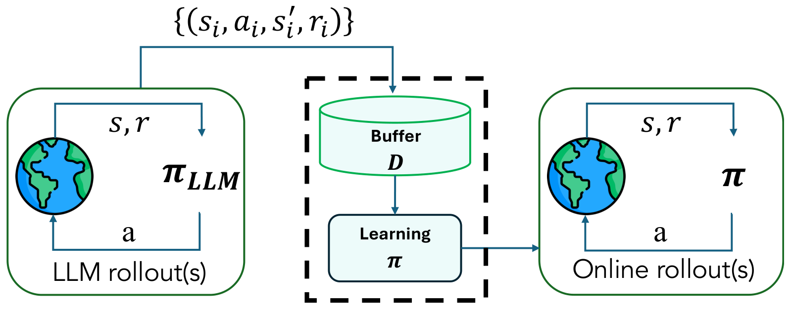

> **图 1**：LLM 离策略预训练、RL 同策略学习（LORO）算法。该图受 Levine 等 [2020] 启发。
>
> 图中流程为：π_LLM 产生"LLM rollout(s)"（给出 s, r, a），数据进入缓冲区 D；由 D 进行"Learning"得到策略 π；π 再产生"Online rollout(s)"（给出 s_t, a_t, s_{t+1}, r_t），新数据回填到缓冲区 D，形成闭环。

---

## 5 实验

我们在大量 RL 环境上对我们的算法[^1]进行经验评估：Cart Pole（倒立摆小车）、Pendulum（摆）、Frozen Lake（冰湖）、Cliff Walking（悬崖行走）、Represented Pong（表示化乒乓）、Mountain Car（山地车）。环境描述与 RL 实现细节见附录 A.1，LLM 设置见附录 B。

[^1]: 我们实验的代码可在 https://github.com/duongnhatthang/LlamaGym 查看。

这里，我们把我们的算法与以下基线进行比较：

- **On-policy（同策略）**：一种经典的在线 RL 方法，算法在线地收集数据并改进其策略。
- **LLMs as Policies（Qwen-7B-Instruct、Qwen-32B-Instruct）**：来自 Qwen 2.5 系列 7B 与 32B 模型、经过指令微调的基础策略 Yang 等 [2024]。对每个回合 t 和每一步 h，LLM 可以访问环境描述和观测描述 s_h^t，并通过思维链（Chain-of-Thought, CoT）Wei 等 [2022] 采取动作 a_h^t。LLM 设置细节见附录 B，提示词设置与示例见附录 C。注意：在下面的图中，我们只展示前 τ 个回合收集到的平均回合回报 r_avg = (1/(Hτ)) Σ_{t=1}^{τ} Σ_{h=1}^{H} r_h^t。
- **Random（随机）**：采用均匀随机动作 a_h^t 的策略 π_random。同样，我们只展示前 τ 个回合收集到的平均回合回报。

在下面的实验中，我们取 τ = 10，预训练步数为 1000。任务长度 T 在 CartPole、FrozenLake 上为 150，在 CliffWalking、Pendulum、RepresentedPong 上为 200，在 MountainCar 上为 300。LORO 使用 Qwen-7B 收集的数据进行训练。为了全面评估 LORO 的有效性并理解影响其性能的潜在因素，我们把实验组织为几个部分：先展示跨多个 RL 环境的主要结果（§5.1），然后进行一系列消融研究，评估预训练（§5.2）、LLM 采集数据的质量（§5.3）以及 LLM 推理能力（§5.4）的影响。此外，我们还探究了 LLM 模型规模、预训练步数以及改变 LLM 数据量 τ 的影响，结果见附录 A.2、A.3、A.4。

### 5.1 主要结果

我们算法的主要结果如图 2 所示。在所有学习曲线中，LORO 的前 τ = 10 个回合展示的是使用纯 LLM 策略时的平均回合回报。此后，LORO 显著优于基于 LLM 的策略和同策略 RL 基线。请注意，基础 LLM 策略通常不是最优的，但它们仍能生成高质量的轨迹来提升 LORO 的样本效率，这印证了假设 1 与 Song 等 [2022] 的主张。

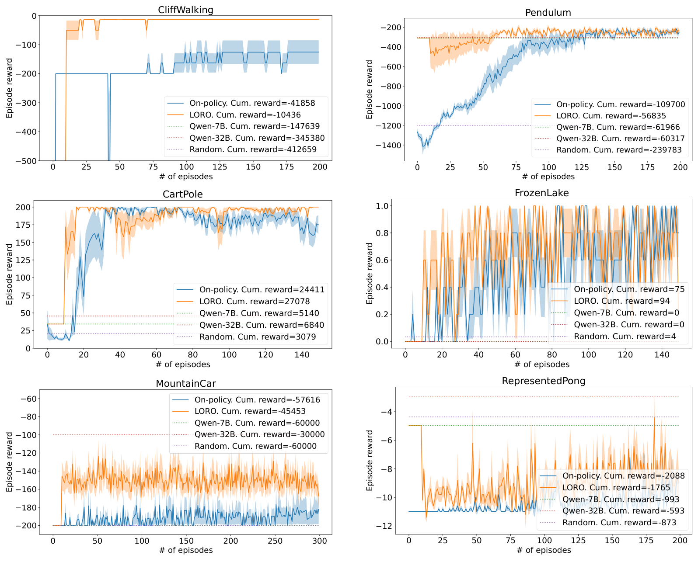

> **图 2**：我们的算法 LORO 优于 LLM 策略（Qwen 7B、Qwen 32B）以及原始的同策略 RL 基线。我们在六个环境上验证了 LORO 的有效性，把学习最优策略所需的数据量降低到原始同策略基线的 1/2 至 1/10。LORO 与同策略基线在前四个环境中都学会了最优策略；即使在未收敛到最优解的情况下，LORO 在后两个环境中仍优于其他基线。LLM 的基础策略在 Pendulum 实验中表现非常好，这可能是因为我们为该设置提供了额外信息（见附录 A.1）。所有结果都给出了 5 个随机种子上的标准误。在 CliffWalking 实验中，部分基线未在图中显示，因为它们的回合回报太小；类似地，在 MountainCar 实验中，多条基线在 −200 处重叠。

**图 2 中各算法的累积回报（cumulative reward）**

| 环境 | On-policy | **LORO** | Qwen-7B | Qwen-32B | Random |
|---|---|---|---|---|---|
| CliffWalking | −41858 | **−10436** | −147639 | −345380 | −412659 |
| Pendulum | −109700 | **−56835** | −61966 | −60317 | −239783 |
| CartPole | 24411 | **27078** | 5140 | 6840 | 3079 |
| FrozenLake | 75 | **94** | 0 | 0 | 4 |
| MountainCar | −57616 | **−45453** | −60000 | −30000 | −60000 |
| RepresentedPong | −2088 | **−1765** | −993 | −593 | −873 |

（表中数值为各环境完整训练过程中的累积回报；粗体为每行最优。）

### 5.2 预训练的作用

我们希望通过消融研究验证预训练（算法 1 第 9 行）对 LORO 性能的重要性。这一研究的动机是：Song 等 [2022] 的算法只把离策略数据与在线数据混合，而不做预训练，以避免对预训练数据过度保守——过度保守可能损害性能。

在图 3 中，我们表明仅混合数据（这等价于 Song 等 [2022]）是不够的。我们的猜想是：预训练这一步让 LORO 只用高质量数据"过拟合"（overfit），而这些数据不包含最优策略较少访问区域的数据。如图 2 所示，与仅仅在 τ 个回合后把 LLM 收集的数据与同策略收集的数据混合相比，预训练显著提升了 LORO 的性能。

尽管预训练在初期可能有用，但为了达到最优行为，智能体仍然需要探索其他状态-动作对——以防初始数据来自一个次优策略，如图 2 中 CartPole 环境所示。

乍看之下，我们的发现与 Song 等 [2022] 之间似乎存在矛盾。Song 等 [2022] 假设可以访问一个大型离策略数据集，并与 Nair 等 [2020] 一样，希望通过把在线数据与离策略数据等同对待，来让策略对离策略数据不那么保守。相反，我们没有离策略数据可访问；我们用 LLM 收集少量高质量数据，因此与 Song 等 [2022] 不同，LORO 在初期对这些观测赋予更大的权重。我们的实验表明，通过对 LLM 数据集"过拟合"而变得保守，反而有助于更高效地学习。

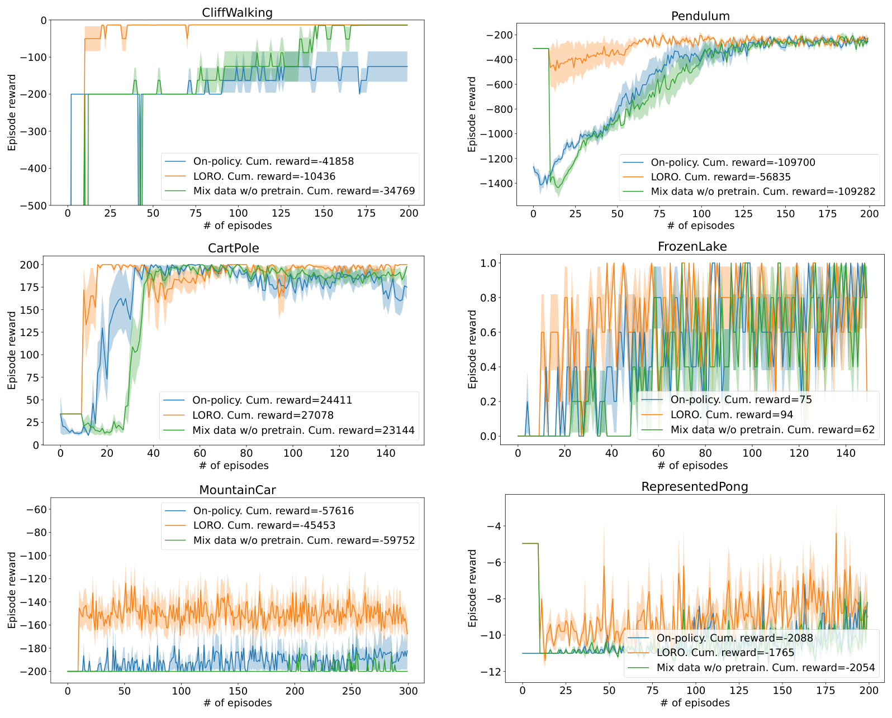

> **图 3**：比较"先预训练（然后丢弃所收集的数据）"与"不预训练、直接把 LLM 收集的数据与同策略数据混合"。很明显，预训练是 LORO 取得优于朴素数据混合性能的必要条件。

**图 3 中的累积回报**

| 环境 | On-policy | **LORO（预训练）** | 仅混合数据、不预训练 |
|---|---|---|---|
| CliffWalking | −41858 | **−10436** | −34769 |
| Pendulum | −109700 | **−56835** | −109282 |
| CartPole | 24411 | **27078** | 23144 |
| FrozenLake | 75 | **94** | 62 |
| MountainCar | −57616 | **−45453** | −59752 |
| RepresentedPong | −2088 | **−1765** | −2054 |

### 5.3 LLM 数据的作用

上一节的图 3 向我们展示了用 LLM 收集的数据进行预训练的重要性。本节我们做一个消融研究，说明这类数据的**质量**至关重要。

在图 4 中，我们表明使用 LLM 收集的数据，显著优于使用"从零开始的同策略 RL 算法"收集的数据，或使用"均匀随机动作策略"收集的数据。因此我们得出结论：预训练只有在配以高质量数据时才有益，这支持了我们上面的猜想。

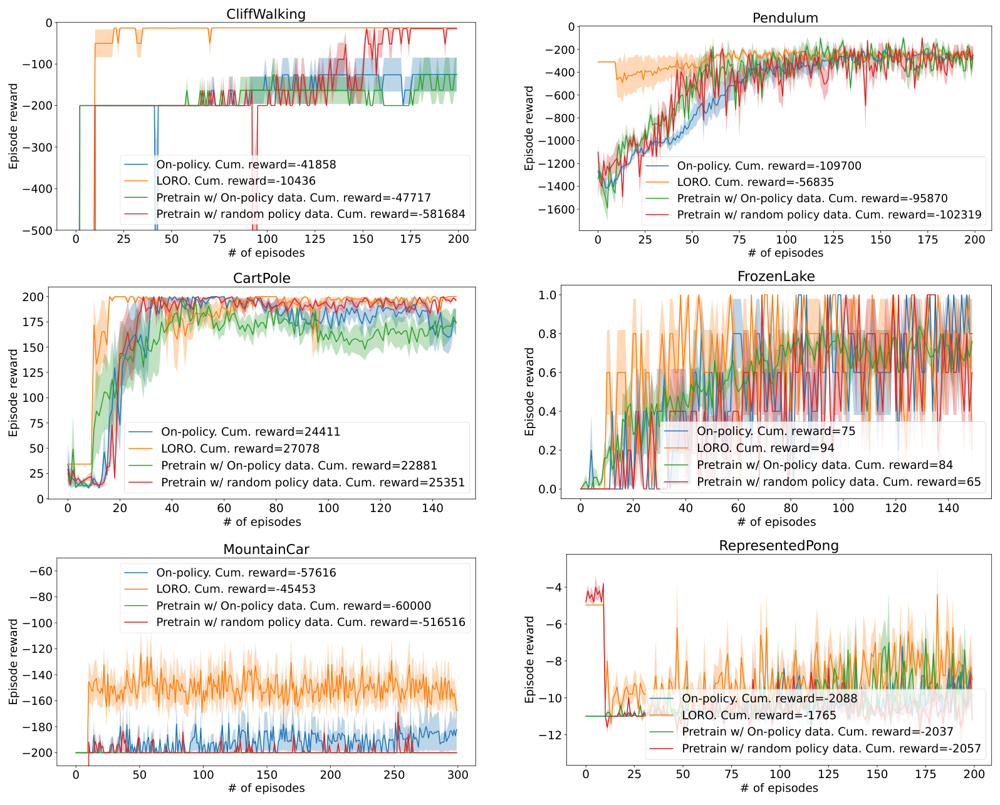

> **图 4**：比较"用 LLM 数据预训练"与"用随机数据、同策略数据预训练"。主要发现是：预训练只有在使用 LLM 数据时才有用。

**图 4 中的累积回报**

| 环境 | On-policy | **LORO（LLM 数据）** | 用同策略数据预训练 | 用随机策略数据预训练 |
|---|---|---|---|---|
| CliffWalking | −41858 | **−10436** | −47717 | −581684 |
| Pendulum | −109700 | **−56835** | −95870 | −102319 |
| CartPole | 24411 | 27078 | 22881 | 25351 |
| FrozenLake | 75 | **94** | 84 | 65 |
| MountainCar | −57616 | **−45453** | −60000 | −516516 |
| RepresentedPong | −2088 | **−1765** | −2037 | −2057 |

### 5.4 LLM 能力的影响

许多推理任务的性能会随着 LLM 能力的提升而提升，途径包括：增大模型规模、使用监督微调（Supervised Fine-Tuning, SFT）、长思维链（Long Chain-of-Thought, Long CoT），或者一些测试时扩展（Test-time-scaling）方法如多数投票（Majority Voting）与 Best-of-N。本节我们想研究：LLM 推理能力的这种提升，是否也能转化为 MDP 问题中决策能力的提升。

从附录 A.2 的实验中，我们没有看到 LLM 模型规模与其性能之间有明确的联系。另一方面，我们注意到只有当使用 CoT、而不是仅仅要求 LLM 做出决策时，LLM 的基础策略才有用。我们还观察到 0.5B 模型没有用，以及不使用 CoT 的多数投票或 Best-of-N 也没有用。因此，在附录 A.5 中，我们想看看用 SFT 提升 LLM 能力、或使用具备长 CoT 的 LLM 是否有帮助。我们表明，使用标准 CoT 与使用 SFT 或 Long CoT 相比没有显著差异。可以理解的是，SFT 不会有帮助，甚至可能适得其反，因为为微调收集的数据量太少、无法产生差异（在我们的实验中大约为 500–3000 条）。因此我们得出结论：LLM 能力的提升并不会直接转化为 RL 任务上的提升。

### 5.5 其他发现

有趣的是，我们发现较小的模型规模（7B）对边界情况（edge cases）更敏感，例如 MountainCar（图 10 中 3000 预训练步的设置）、CartPole（图 8 中 10 个训练回合、1000 预训练步的设置）、以及 FrozenLake（图 27 中糟糕的环境历史摘要）。我们还发现，预训练数据量总体上不影响累积回报，这一点见附录 A.4。唯一的例外是图 5 中的 CartPole 环境，可能是因为该环境对同策略基线来说太容易学会最优策略了。

除上述报告的内容之外，我们发现任务的性能与预训练步数或模型规模之间没有明确关系，这些见附录 A.3、A.2。我们也没有发现离散动作环境与连续动作环境（例如 Pendulum）之间有明确差异，尽管直觉上离散动作环境对 LLM 应该更容易 Singh 等 [2025]。


> **图 5**：比较 CartPole 环境下不同预训练数据量的效果。这是一个罕见的边界情况：使用 LORO 反而比同策略基线更差。
>
> （图 5 中：平滑后的 1000 步 / 7B 设置下，On-policy 累积回报 24411，LORO 用 10 个预训练回合为 6705，用 20 个为 24430，用 30 个为 20501。）

---

## 6 结论与未来工作

本文研究了如何利用 LLM 为传统 RL 方法提供热启动。在实验上，我们证明了 LLM 收集的高质量数据可以显著提升在线 RL 的样本效率。在假设 1 之下，我们的算法得到了 Song 等 [2022] 的累积次优性遗憾与样本复杂度保证的支持。

我们的工作为显著降低 RL 问题中的样本复杂度提供了一个框架。这对于数据采集成本或安全性是主要关切的现实应用尤为重要。我们工作的一个局限是：假设 1 在某些 RL 任务中可能不成立；但我们相信，随着 LLM 能力的不断增强，假设 1 适用的问题范围会扩大。未来，我们希望把这项工作扩展到状态空间与动作空间更大的、更复杂的 RL 问题中；我们也希望研究如何让样本效率随 LLM 能力的提升而扩展。

---

## 参考文献

（按原文顺序，保留英文原貌）

1. Mostafa Abdou, Artur Kulmizev, Daniel Hershcovich, Stella Frank, Ellie Pavlick, and Anders Søgaard. Can language models encode perceptual structure without grounding? a case study in color. arXiv preprint arXiv:2109.06129, 2021.
2. Alekh Agarwal, Nan Jiang, Sham M Kakade, and Wen Sun. Reinforcement learning: Theory and algorithms. CS Dept., UW Seattle, Seattle, WA, USA, Tech. Rep, 32:96, 2019.
3. Michael Ahn, Anthony Brohan, Noah Brown, Yevgen Chebotar, Omar Cortes, Byron David, Chelsea Finn, Chuyuan Fu, Keerthana Gopalakrishnan, Karol Hausman, et al. Do as i can, not as i say: Grounding language in robotic affordances. arXiv preprint arXiv:2204.01691, 2022.
4. Ankesh Anand, Evan Racah, Sherjil Ozair, Yoshua Bengio, Marc-Alexandre Côté, and R Devon Hjelm. Unsupervised state representation learning in atari. arXiv preprint arXiv:1906.08226, 2019.
5. Dilip Arumugam and Thomas L. Griffiths. Toward efficient exploration by large language model agents, 2025. URL https://arxiv.org/abs/2504.20997.
6. Philip J. Ball, Laura Smith, Ilya Kostrikov, and Sergey Levine. Efficient online reinforcement learning with offline data, 2023. URL https://arxiv.org/abs/2302.02948.
7. Dimitri P Bertsekas. Neuro-dynamic programming: An overview and recent results. In Operations Research Proceedings 2006, pages 71–72. Springer, 2007.
8. Vineet Bhat, Ali Umut Kaypak, Prashanth Krishnamurthy, Ramesh Karri, and Farshad Khorrami. Grounding llms for robot task planning using closed-loop state feedback. arXiv preprint arXiv:2402.08546, 2024.
9. Tom Brown, Benjamin Mann, Nick Ryder, Melanie Subbiah, Jared D Kaplan, Prafulla Dhariwal, Arvind Neelakantan, Pranav Shyam, Girish Sastry, Amanda Askell, et al. Language models are few-shot learners. Advances in neural information processing systems, 33:1877–1901, 2020.
10. Thomas Carta, Clément Romac, Thomas Wolf, Sylvain Lamprier, Olivier Sigaud, and Pierre-Yves Oudeyer. Grounding large language models in interactive environments with online reinforcement learning. In International Conference on Machine Learning, pages 3676–3713. PMLR, 2023.
11. Dingyang Chen, Qi Zhang, and Yinglun Zhu. Efficient sequential decision making with large language models. arXiv preprint arXiv:2406.12125, 2024.
12. Kristy Choi, Chris Cundy, Sanjari Srivastava, and Stefano Ermon. Lmpriors: Pre-trained language models as task-specific priors. arXiv preprint arXiv:2210.12530, 2022.
13. Murtaza Dalal, Tarun Chiruvolu, Devendra Chaplot, and Ruslan Salakhutdinov. Plan-seq-learn: Language model guided rl for solving long horizon robotics tasks. arXiv preprint arXiv:2405.01534, 2024.
14. Yuqing Du, Olivia Watkins, Zihan Wang, Cédric Colas, Trevor Darrell, Pieter Abbeel, Abhishek Gupta, and Jacob Andreas. Guiding pretraining in reinforcement learning with large language models. In International Conference on Machine Learning, pages 8657–8677. PMLR, 2023.
15. Damien Ernst, Pierre Geurts, and Louis Wehenkel. Tree-based batch mode reinforcement learning. Journal of Machine Learning Research, 6, 2005.
16. Tuomas Haarnoja, Aurick Zhou, Kristian Hartikainen, George Tucker, Sehoon Ha, Jie Tan, Vikash Kumar, Henry Zhu, Abhishek Gupta, Pieter Abbeel, and Sergey Levine. Soft actor-critic algorithms and applications, 2019. URL https://arxiv.org/abs/1812.05905.
17. Yilun Hao, Yang Zhang, and Chuchu Fan. Planning anything with rigor: General-purpose zero-shot planning with llm-based formalized programming. arXiv preprint arXiv:2410.12112, 2024.
18. Todd Hester, Matej Vecerik, Olivier Pietquin, Marc Lanctot, Tom Schaul, Bilal Piot, Dan Horgan, John Quan, Andrew Sendonaris, Ian Osband, et al. Deep q-learning from demonstrations. In Proceedings of the AAAI conference on artificial intelligence, volume 32, 2018.
19. Yining Hong, Haoyu Zhen, Peihao Chen, Shuhong Zheng, Yilun Du, Zhenfang Chen, and Chuang Gan. 3d-llm: Injecting the 3d world into large language models. Advances in Neural Information Processing Systems, 36:20482–20494, 2023.
20. Edward J. Hu, Yelong Shen, Phillip Wallis, Zeyuan Allen-Zhu, Yuanzhi Li, Shean Wang, Lu Wang, and Weizhu Chen. Lora: Low-rank adaptation of large language models, 2021. URL https://arxiv.org/abs/2106.09685.
21. Chenguang Huang, Oier Mees, Andy Zeng, and Wolfram Burgard. Visual language maps for robot navigation. In 2023 IEEE International Conference on Robotics and Automation (ICRA), pages 10608–10615. IEEE, 2023.
22. Wenlong Huang, Fei Xia, Ted Xiao, Harris Chan, Jacky Liang, Pete Florence, Andy Zeng, Jonathan Tompson, Igor Mordatch, Yevgen Chebotar, et al. Inner monologue: Embodied reasoning through planning with language models. arXiv preprint arXiv:2207.05608, 2022.
23. Hyeongyo Jeong, Haechan Lee, Changwon Kim, and Sungtae Shin. A survey of robot intelligence with large language models. Applied Sciences, 14(19), 2024. doi: 10.3390/app14198868.
24. Jarvis K. Bench llm deciders with gym translators. GitHub, 2024. URL https://github.com/mail-ecnu/Text-Gym-Agents.
25. Yash Kant, Arun Ramachandran, Sriram Yenamandra, Igor Gilitschenski, Dhruv Batra, Andrew Szot, and Harsh Agrawal. Housekeep: Tidying virtual households using commonsense reasoning. In European Conference on Computer Vision, pages 355–373. Springer, 2022.
26. Jens Kober, J Andrew Bagnell, and Jan Peters. Reinforcement learning in robotics: A survey. The International Journal of Robotics Research, 32(11):1238–1274, 2013.
27. Akshay Krishnamurthy, Keegan Harris, Dylan J Foster, Cyril Zhang, and Aleksandrs Slivkins. Can large language models explore in-context? arXiv preprint arXiv:2403.15371, 2024.
28. Sascha Lange, Thomas Gabel, and Martin Riedmiller. Batch reinforcement learning. In Reinforcement learning: State-of-the-art, pages 45–73. Springer, 2012.
29. Jonathan Lee, Annie Xie, Aldo Pacchiano, Yash Chandak, Chelsea Finn, Ofir Nachum, and Emma Brunskill. Supervised pretraining can learn in-context reinforcement learning. Advances in Neural Information Processing Systems, 36:43057–43083, 2023.
30. Sergey Levine, Aviral Kumar, George Tucker, and Justin Fu. Offline reinforcement learning: Tutorial, review, and perspectives on open problems. arXiv preprint arXiv:2005.01643, 2020.
31. Jacky Liang, Wenlong Huang, Fei Xia, Peng Xu, Karol Hausman, Brian Ichter, Pete Florence, and Andy Zeng. Code as policies: Language model programs for embodied control. In 2023 IEEE International Conference on Robotics and Automation (ICRA), pages 9493–9500. IEEE, 2023.
32. Licong Lin, Yu Bai, and Song Mei. Transformers as decision makers: Provable in-context reinforcement learning via supervised pretraining. arXiv preprint arXiv:2310.08566, 2023.
33. Shaowei Liu, Zhongzheng Ren, Saurabh Gupta, and Shenlong Wang. Physgen: Rigid-body physics-grounded image-to-video generation. In European Conference on Computer Vision, pages 360–378. Springer, 2024.
34. Jelena Luketina, Nantas Nardelli, Gregory Farquhar, Jakob Foerster, Jacob Andreas, Edward Grefenstette, Shimon Whiteson, and Tim Rocktäschel. A survey of reinforcement learning informed by natural language. arXiv preprint arXiv:1906.03926, 2019.
35. Yecheng Jason Ma, William Liang, Guanzhi Wang, De-An Huang, Osbert Bastani, Dinesh Jayaraman, Yuke Zhu, Linxi Fan, and Anima Anandkumar. Eureka: Human-level reward design via coding large language models. arXiv preprint arXiv:2310.12931, 2023.
36. Ashvin Nair, Bob McGrew, Marcin Andrychowicz, Wojciech Zaremba, and Pieter Abbeel. Overcoming exploration in reinforcement learning with demonstrations. In 2018 IEEE international conference on robotics and automation (ICRA), pages 6292–6299. IEEE, 2018.
37. Ashvin Nair, Abhishek Gupta, Murtaza Dalal, and Sergey Levine. Awac: Accelerating online reinforcement learning with offline datasets. arXiv preprint arXiv:2006.09359, 2020.
38. Allen Nie, Yi Su, Bo Chang, Jonathan N Lee, Ed H Chi, Quoc V Le, and Minmin Chen. Evolve: Evaluating and optimizing llms for exploration. arXiv preprint arXiv:2410.06238, 2024.
39. Rohan Pandey. Llamagym: Fine-tune llm agents with online reinforcement learning. GitHub, 2024. URL https://github.com/KhoomeiK/LlamaGym.
40. Roma Patel and Ellie Pavlick. Mapping language models to grounded conceptual spaces. In International conference on learning representations, 2022.
41. Arunselvan Ramaswamy and Eyke Hüllermeier. Deep q-learning: Theoretical insights from an asymptotic analysis, 2021. URL https://arxiv.org/abs/2008.10870.
42. Martin Riedmiller. Neural fitted q iteration–first experiences with a data efficient neural reinforcement learning method. In Machine learning: ECML 2005, pages 317–328. Springer, 2005.
43. Simon Schmitt, Jonathan J Hudson, Augustin Zidek, Simon Osindero, Carl Doersch, Wojciech M Czarnecki, Joel Z Leibo, Heinrich Kuttler, Andrew Zisserman, Karen Simonyan, et al. Kickstarting deep reinforcement learning. arXiv preprint arXiv:1803.03835, 2018.
44. Takuma Seno and Michita Imai. d3rlpy: An offline deep reinforcement learning library. Journal of Machine Learning Research, 23(315):1–20, 2022.
45. David Silver, Julian Schrittwieser, Karen Simonyan, Ioannis Antonoglou, Aja Huang, Arthur Guez, Thomas Hubert, Lucas Baker, Matthew Lai, Adrian Bolton, et al. Mastering the game of go without human knowledge. nature, 550(7676):354–359, 2017.
46. Shrutika Singh, Anton Alyakin, Daniel Alexander Alber, Jaden Stryker, Ai Phuong S Tong, Karl Sangwon, Nicolas Goff, Mathew de la Paz, Miguel Hernandez-Rovira, Ki Yun Park, Eric Claude Leuthardt, and Eric Karl Oermann. It is too many options: Pitfalls of multiple-choice questions in generative ai and medical education, 2025. URL https://arxiv.org/abs/2503.13508.
47. Yuda Song, Yifei Zhou, Ayush Sekhari, J Andrew Bagnell, Akshay Krishnamurthy, and Wen Sun. Hybrid rl: Using both offline and online data can make rl efficient. arXiv preprint arXiv:2210.06718, 2022.
48. Weihao Tan, Wentao Zhang, Shanqi Liu, Longtao Zheng, Xinrun Wang, and Bo An. True knowledge comes from practice: Aligning llms with embodied environments via reinforcement learning. arXiv preprint arXiv:2401.14151, 2024.
49. Mark Towers, Ariel Kwiatkowski, Jordan Terry, John U Balis, Gianluca De Cola, Tristan Deleu, Manuel Goulão, Andreas Kallinteris, Markus Krimmel, Arjun KG, et al. Gymnasium: A standard interface for reinforcement learning environments. arXiv preprint arXiv:2407.17032, 2024.
50. Masatoshi Uehara, Xuezhou Zhang, and Wen Sun. Representation learning for online and offline rl in low-rank mdps. arXiv preprint arXiv:2110.04652, 2021.
51. Hado van Hasselt, Arthur Guez, and David Silver. Deep reinforcement learning with double q-learning, 2015. URL https://arxiv.org/abs/1509.06461.
52. Ruosong Wang, Yifan Wu, Ruslan Salakhutdinov, and Sham Kakade. Instabilities of offline rl with pre-trained neural representation. In International Conference on Machine Learning, pages 10948–10960. PMLR, 2021.
53. Jason Wei, Xuezhi Wang, Dale Schuurmans, Maarten Bosma, Fei Xia, Ed Chi, Quoc V Le, Denny Zhou, et al. Chain-of-thought prompting elicits reasoning in large language models. Advances in neural information processing systems, 35:24824–24837, 2022.
54. Tengyang Xie, Nan Jiang, Huan Wang, Caiming Xiong, and Yu Bai. Policy finetuning: Bridging sample-efficient offline and online reinforcement learning. Advances in neural information processing systems, 34:27395–27407, 2021.
55. Tianbao Xie, Siheng Zhao, Chen Henry Wu, Yitao Liu, Qian Luo, Victor Zhong, Yanchao Yang, and Tao Yu. Text2reward: Automated dense reward function generation for reinforcement learning. arXiv preprint arXiv:2309.11489, 2023.
56. An Yang, Baosong Yang, Beichen Zhang, Binyuan Hui, Bo Zheng, Bowen Yu, Chengyuan Li, Dayiheng Liu, Fei Huang, Haoran Wei, et al. Qwen2.5 technical report. arXiv preprint arXiv:2412.15115, 2024.
57. Shunyu Yao, Jeffrey Zhao, Dian Yu, Nan Du, Izhak Shafran, Karthik Narasimhan, and Yuan Cao. React: Synergizing reasoning and acting in language models. arXiv preprint arXiv:2210.03629, 2022.
58. Ruiqi Zhang and Andrea Zanette. Policy finetuning in reinforcement learning via design of experiments using offline data. Advances in Neural Information Processing Systems, 36:59953–59995, 2023.
59. Qinqing Zheng, Amy Zhang, and Aditya Grover. Online decision transformer. In Proceedings of the 39th International Conference on Machine Learning, volume 162 of PMLR, pages 27042–27059. PMLR, 2022.
60. Andy Zhou, Kai Yan, Michal Shlapentokh-Rothman, Haohan Wang, and Yu-Xiong Wang. Language agent tree search unifies reasoning acting and planning in language models. arXiv preprint arXiv:2310.04406, 2023.

---

## 附录 A 消融实验

### A.1 环境与实现细节

#### A.1.1 环境

我们在一些经典的 RL 环境上对算法进行经验验证：

- **Cart Pole（倒立摆小车）**：智能体的目标是通过左右移动小车，让一根杆子在小车顶上保持平衡。它观测小车位置（Cart Position）、小车速度（Cart Velocity）、杆角（Pole Angle）和杆角速度（Pole Angular Velocity）。在回合结束之前（回合结束的原因包括：杆倒下、小车移到显示边缘、或达到最大回合长度），每走一步奖励为 1。
- **Pendulum（摆）**：智能体的目标是通过在其自由端施加扭矩，把一个倒立摆荡起来。它观测摆的自由端的 (x, y) 位置及其角速度。为了帮助 LLM，我们从位置计算出摆的角度和旋转方向，但在在线阶段不使用这些量。奖励根据摆的角度计算，竖直向上的位置奖励最高。达到最大回合长度时回合结束。注意这里的动作集是连续的，这可能对 LLM 的策略更具挑战性。
- **Frozen Lake（冰湖）**：智能体的目标是在一个 4×4 的网格世界中从左上角移动到右下角。智能体可以上、下、左、右移动，且只观测自己的位置。除目标点奖励为 1 外，其他地方奖励均为 0。回合结束于智能体移动到网格中的四个"洞"之一、到达目标、或达到最大回合长度。我们还额外实现了一个外部环境历史（external environment history），用来存储每个到访位置所获得的奖励，这对 LLM 求解该任务是必要的。该环境历史在在线学习阶段不被使用。
- **Cliff Walking（悬崖行走）**：智能体的目标是在一个 4×12 的网格世界中从左下角移动到右下角。智能体可以上、下、左、右移动，且只观测自己的位置。除网格底部悬崖位置奖励为 −100 之外，其余位置奖励均为 −1。回合结束于智能体到达目标或达到最大回合长度。该环境我们也使用了环境历史。
- **Represented Pong（表示化乒乓）**：这是 Atari 游戏 Pong，但我们不使用传统的图像观测，而是用 Anand 等 [2019] 的方法从 RAM 状态中提取游戏状态信息。于是智能体观测自己、球、对手的坐标以及比分。我们还计算了球的速度并把它加入观测，因为看来这对于保证马尔可夫性（只用当前状态信息就能采取最优动作）是必要的。智能体控制右侧挡板上下移动，与由计算机控制的左侧挡板对抗，试图把球从自己的球门弹开、打向对手球门。智能体每次得分得一分，对手得分则失分。当某一方得分达到 21 分、或智能体达到最大回合长度时游戏结束。
- **Mountain Car（山地车）**：智能体的目标是尽快从正弦形山谷的底部移动到右侧山顶。智能体可以策略性地向左或向右加速。它只观测自己的位置和速度。除目标点外，各处奖励均为 −1。回合结束于智能体到达目标或达到最大回合长度。

#### A.1.2 实现细节

我们的代码基于 Pandey [2024] 构建，该框架提供了 LLM 与 OpenAI 的 gym 游戏交互的能力，并内置了一个文本描述包装器，把 RL 游戏转换成 LLM 可以玩的形态。游戏描述见附录 C，大量参考了 K [2024]。RL 训练过程使用 d3rlpy Seno 和 Imai [2022]，采用默认超参数选择，其中批大小为 256、缓冲区大小为 100,000、ε = 0.1、γ = 0.99、目标网络更新间隔为 1,000、学习率为 5e−5。我们在所有离散动作任务上使用 DDQN van Hasselt 等 [2015]，在连续动作上使用 SAC Haarnoja 等 [2019]。LLM 在两块 H100 GPU 上运行。

对于 LORO 算法，我们收集数据来预训练一个策略，然后在在线学习过程中只使用在线数据。

### A.2 LLM 模型规模的影响

本节我们评估 LLM 模型规模对策略累积回报的影响。我们在六个 OpenAI Gym 环境上，用不同的预训练数据和预训练步数进行评估，结果见图 6、7、8、9、10、11。总体而言，我们观察到使用更大的模型对提升 LORO 策略的决策质量并没有明显优势。

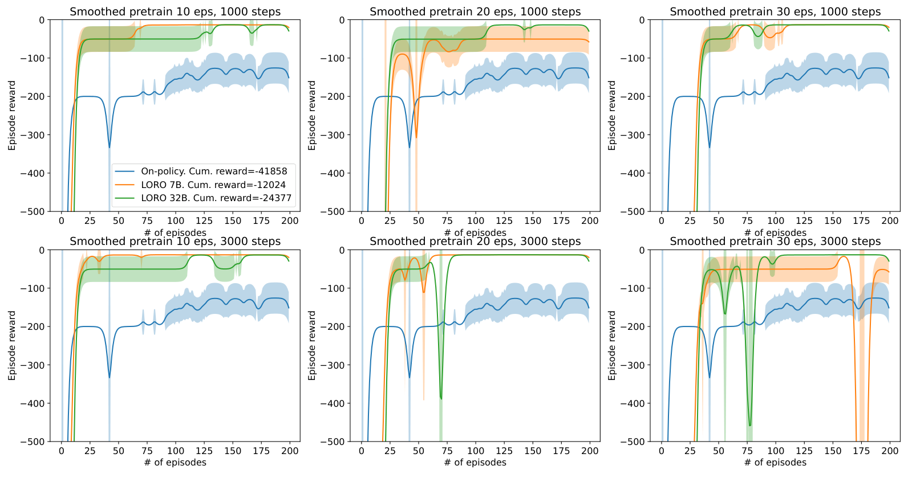

> **图 6**：CliffWalking 环境下不同 LLM 模型规模的比较（各子图为 10/20/30 个预训练回合 × 1000/3000 预训练步，7B 与 32B 对比）。

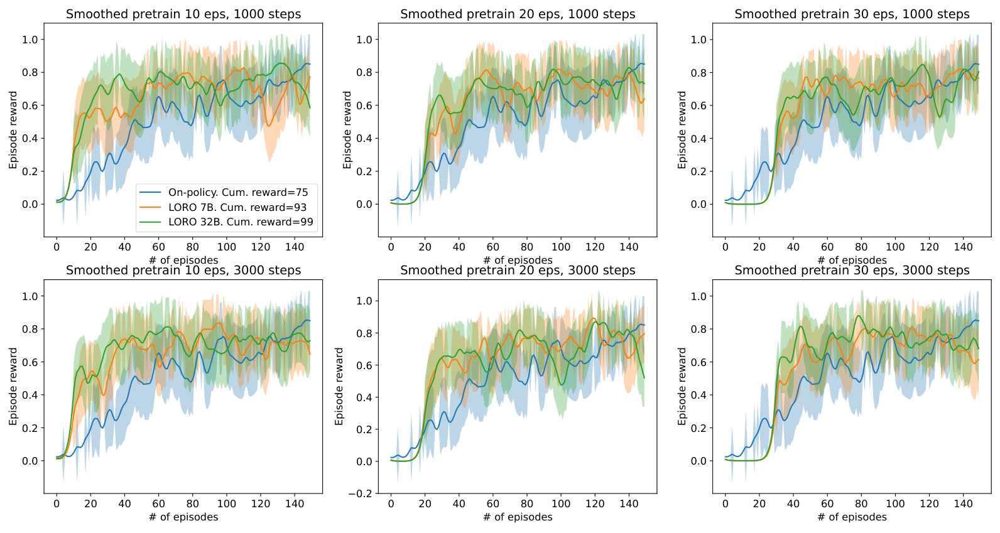

> **图 7**：FrozenLake 环境下不同 LLM 模型规模的比较。

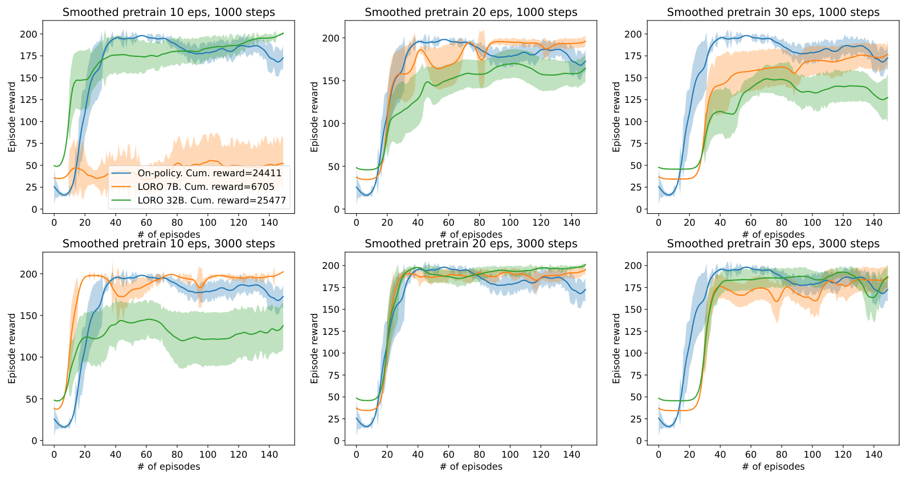

> **图 8**：CartPole 环境下不同 LLM 模型规模的比较。

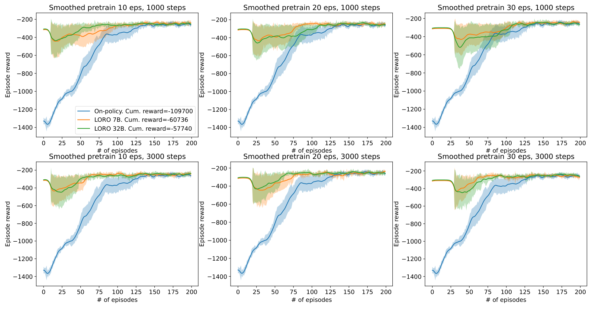

> **图 9**：Pendulum 环境下不同 LLM 模型规模的比较。

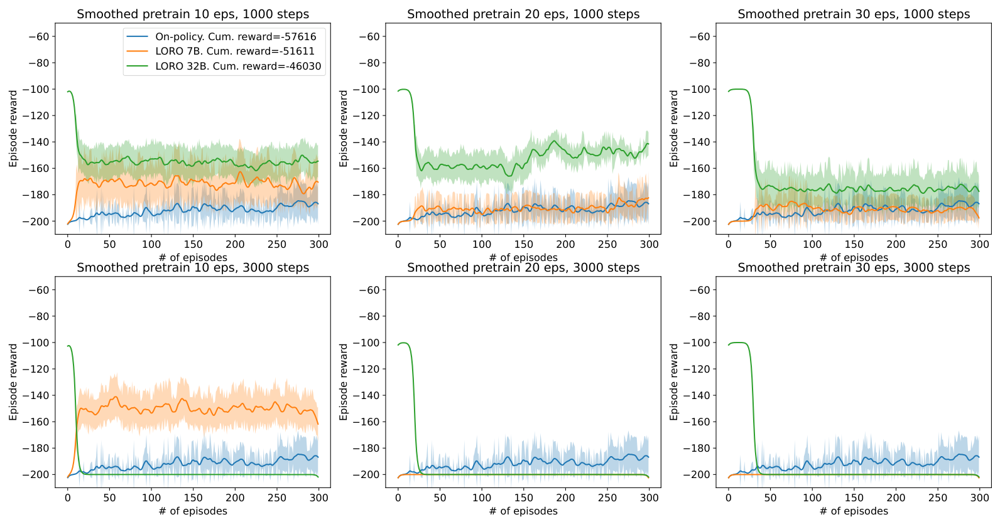

> **图 10**：MountainCar 环境下不同 LLM 模型规模的比较。

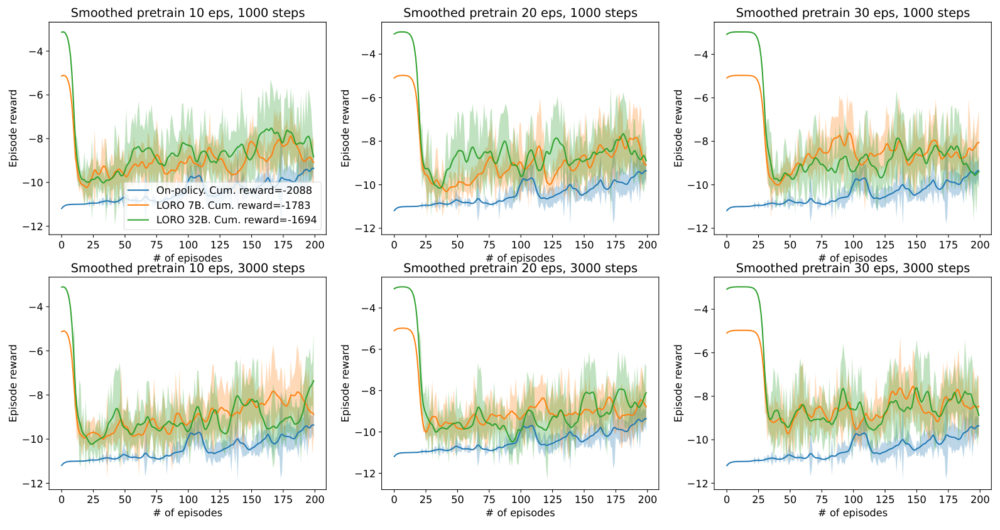

> **图 11**：Pong 环境下不同 LLM 模型规模的比较。
>
> 各图中代表性数值（10 个预训练回合、1000 预训练步的默认设置）：CliffWalking 上 On-policy −41858、LORO 7B −12024、LORO 32B −24377；FrozenLake 上 On-policy 75、LORO 7B 93、LORO 32B 99；CartPole 上 On-policy 24411、LORO 7B 6705、LORO 32B 25477；Pendulum 上 On-policy −109700、LORO 7B −60736、LORO 32B −57740；MountainCar 上 On-policy −57616、LORO 7B −51611、LORO 32B −46030；Pong 上 On-policy −2088、LORO 7B −1783、LORO 32B −1694。

### A.3 预训练步数的影响

本节我们评估预训练步数对策略累积回报的影响。我们在六个 OpenAI Gym 环境上，用不同的模型规模和预训练数据进行评估，结果见图 12、13、14、15、16、17。总体而言，我们观察到使用更多或更少的预训练步数，对提升 LORO 策略的决策质量并没有明显优势。

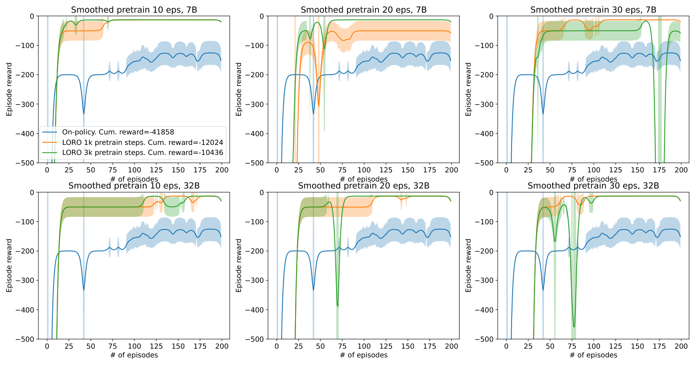

> **图 12**：CliffWalking 环境下不同预训练步数的比较（10/20/30 个预训练回合 × 7B/32B × 1k/3k 步）。

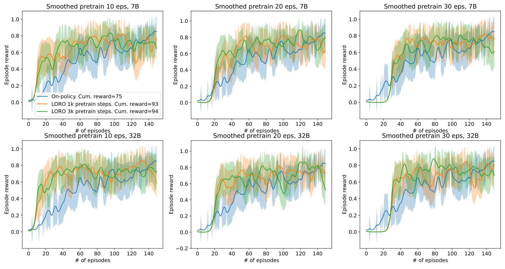

> **图 13**：FrozenLake 环境下不同预训练步数的比较。

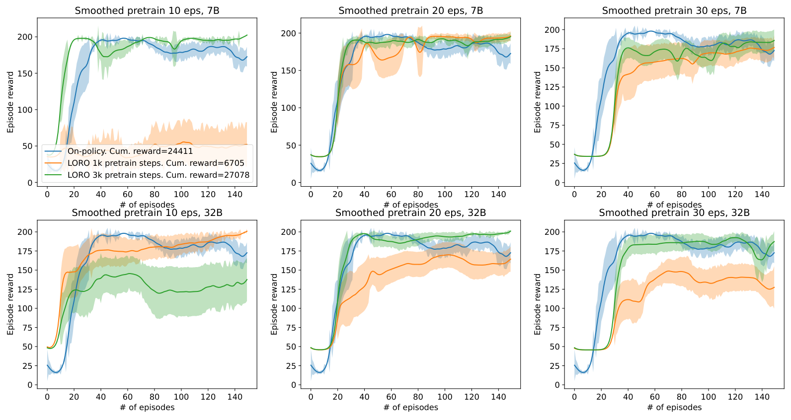

> **图 14**：CartPole 环境下不同预训练步数的比较。

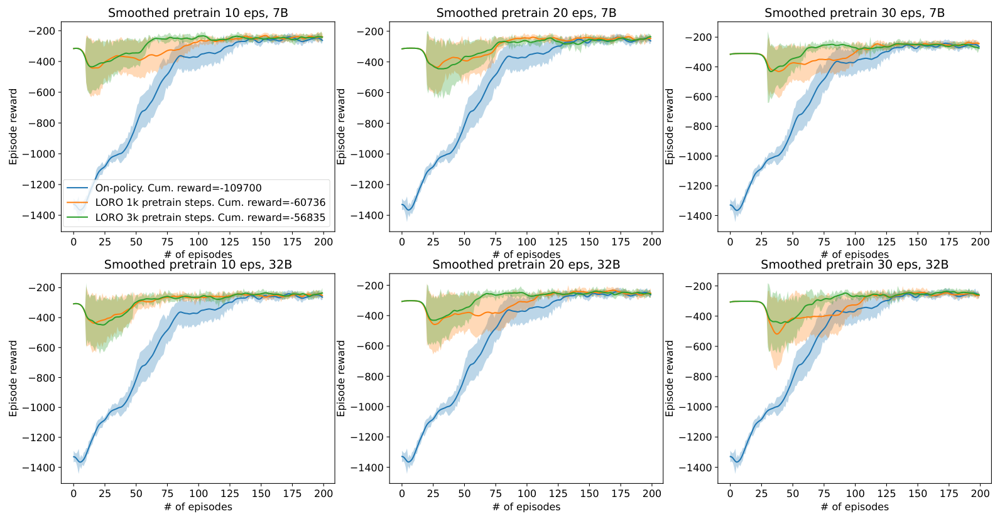

> **图 15**：Pendulum 环境下不同预训练步数的比较。

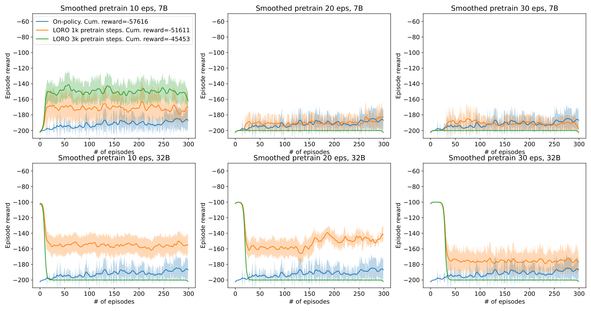

> **图 16**：MountainCar 环境下不同预训练步数的比较。

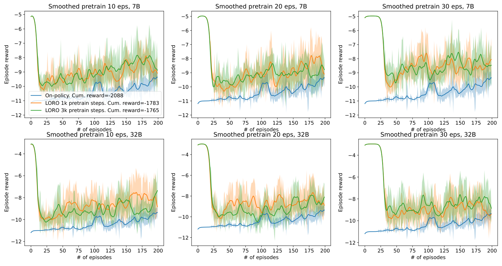

> **图 17**：Pong 环境下不同预训练步数的比较。
>
> 代表性数值（10 个预训练回合、7B）：CliffWalking 上 On-policy −41858、LORO 1k 步 −12024、LORO 3k 步 −10436；FrozenLake 上 On-policy 75、LORO 1k 步 93、LORO 3k 步 94；CartPole 上 On-policy 24411、LORO 1k 步 6705、LORO 3k 步 27078；Pendulum 上 On-policy −109700、LORO 1k 步 −60736、LORO 3k 步 −56835；MountainCar 上 On-policy −57616、LORO 1k 步 −51611、LORO 3k 步 −45453；Pong 上 On-policy −2088、LORO 1k 步 −1783、LORO 3k 步 −1765。

### A.4 LLM 数据量的影响

本节我们评估预训练数据量对策略累积回报的影响。我们在六个 OpenAI Gym 环境上，用不同的模型规模和预训练步数进行评估，结果见图 18、19、20、21、22、23。尽管累积回报存在一些差异，但所有基线都在相对较短的时间内收敛到性能相近的策略。因此，我们观察到使用更多或更少的预训练数据，对提升 LORO 策略的决策质量并没有明显优势。

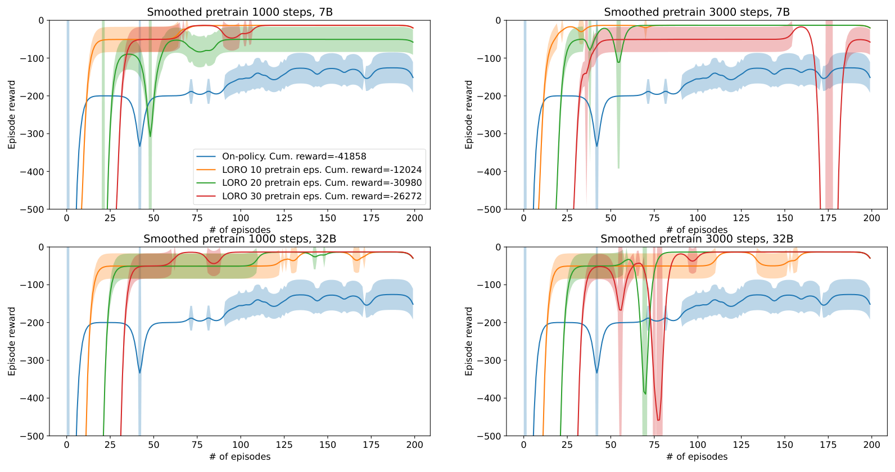

> **图 18**：CliffWalking 环境下不同预训练数据量的比较（10/20/30 个预训练回合 × 1000/3000 步 × 7B/32B）。

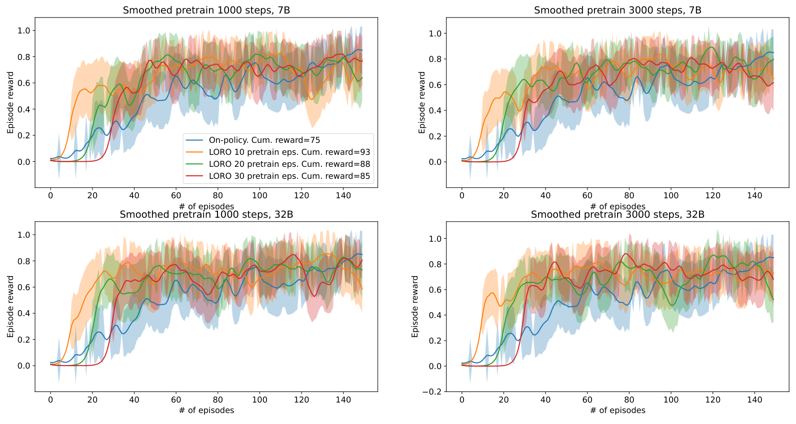

> **图 19**：FrozenLake 环境下不同预训练数据量的比较。

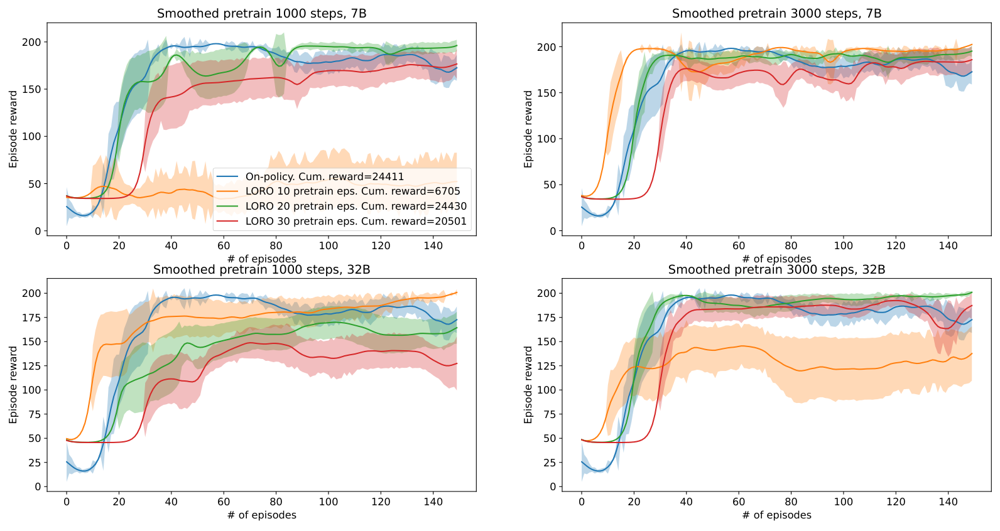

> **图 20**：CartPole 环境下不同预训练数据量的比较。

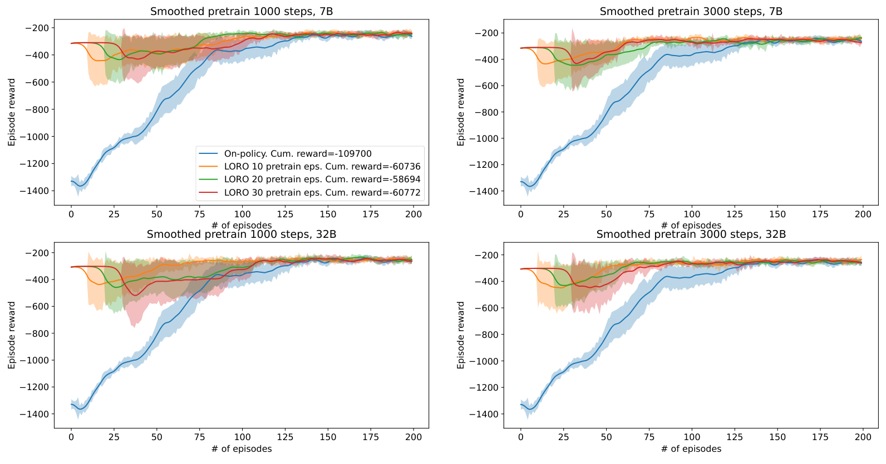

> **图 21**：Pendulum 环境下不同预训练数据量的比较。

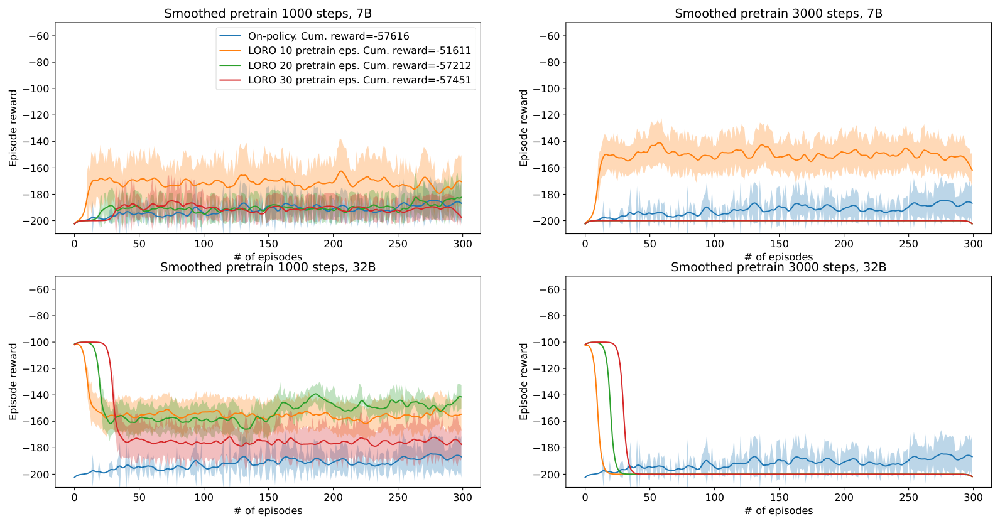

> **图 22**：MountainCar 环境下不同预训练数据量的比较。

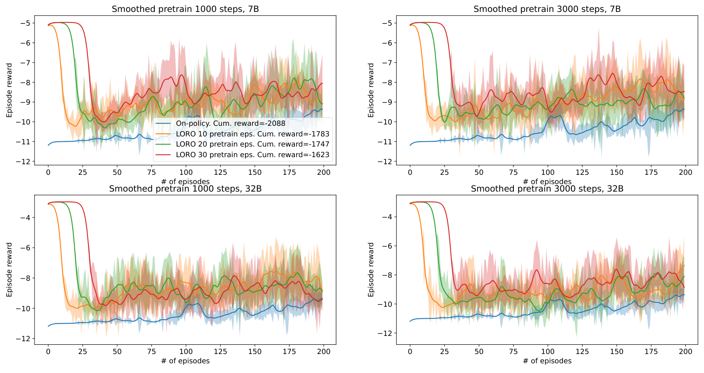

> **图 23**：Pong 环境下不同预训练数据量的比较。
>
> 代表性数值（1000 步、7B）：CliffWalking 上 On-policy −41858、LORO 10 回合 −12024、20 回合 −30980、30 回合 −26272；FrozenLake 上 On-policy 75、LORO 10 回合 93、20 回合 88、30 回合 85；CartPole 上 On-policy 24411、LORO 10 回合 6705、20 回合 24430、30 回合 20501；Pendulum 上 On-policy −109700、LORO 10 回合 −60736、20 回合 −58694、30 回合 −60772；MountainCar 上 On-policy −57616、LORO 10 回合 −51611、20 回合 −57212、30 回合 −57451；Pong 上 On-policy −2088、LORO 10 回合 −1783、20 回合 −1747、30 回合 −1623。

### A.5 SFT 与长思维链（Long CoT）的影响

本节我们评估 SFT 与 Long CoT 对策略累积回报的影响。我们在三个 OpenAI Gym 环境上，用不同的预训练数据和预训练步数进行评估，结果见图 24、25、26。总体而言，我们观察到使用 SFT 和 Long CoT 相对于原始 CoT，在提升 LORO 策略的决策质量上并没有明显优势。

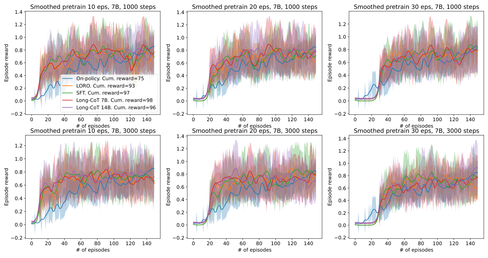

> **图 24**：FrozenLake 环境下 Long Chain-of-Thought 与监督微调（SFT）效果的比较。数值（10 回合、7B、1000 步）：On-policy 75、LORO 93、SFT 97、Long-CoT 7B 98、Long-CoT 14B 96。

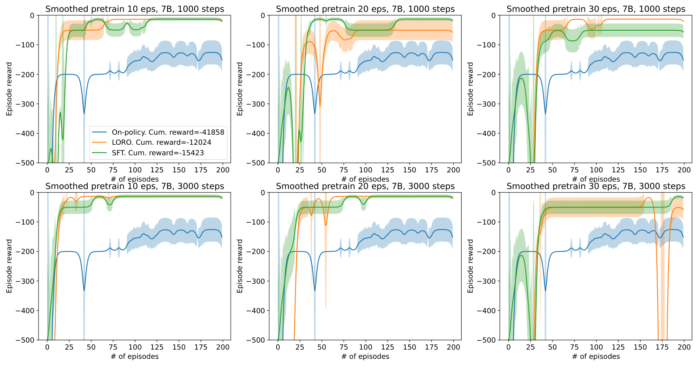

> **图 25**：CliffWalking 环境下 SFT 的效果。数值（10 回合、7B、1000 步）：On-policy −41858、LORO −12024、SFT −15423。

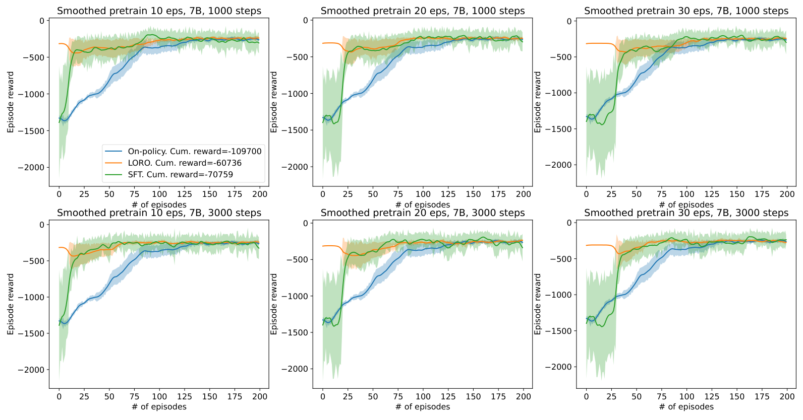

> **图 26**：Pendulum 环境下 SFT 的效果。数值（10 回合、7B、1000 步）：On-policy −109700、LORO −60736、SFT −70759。

### A.6 历史摘要的影响

在上述实验中，我们使用了一种高效的环境历史摘要，例如："洞位于位置：X、Y、Z。你在位置 A、B、C、D 获得零奖励"。

而图 27 的实验则把每个状态的观测直接拼接进 LLM 的提示中，并限制历史长度，形如："你访问位置 X 并获得零奖励。你访问位置 Y 并获得一点奖励。你访问……"。

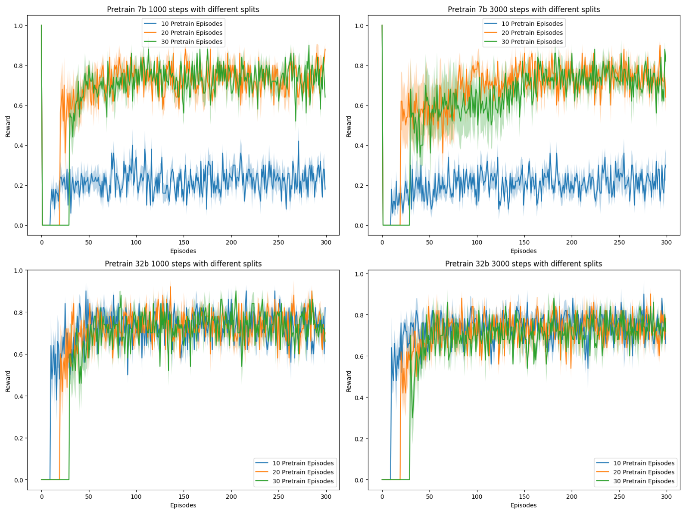

> **图 27**：使用低效环境历史的 FrozenLake 实验。

---

## 附录 B LLM 设置

我们设计提示词，让 LLM 从一个从 1 开始的整数列表中选择动作，因为我们观察到 LLM 对动作 0 有更强的偏好。在 LLM 选择动作之后，我们通过取 LLM 返回的最后一个数字来提取动作。这一设计继承自 Pandey [2024]，尚有改进空间——因为在我们的实验中观察到了不少提取失败的情况。

我们观察到，LLM 的原始设计（只要求它返回所选动作）表现很差。类似地，我们实现并测试了多数投票（Majority Voting）与 Best-of-N 测试时扩展方法，但在没有 CoT 的情况下，它们都表现很差。

所有实验中，我们将生成 token 数限制在 2000 以内，top-p 取 0.6，top-k 取 0，温度取 0.9。在 SFT 实验中，LLM 使用 LORA Hu 等 [2021] 训练，rank 为 8、alpha 为 16、dropout 为 0.05、批大小为 1，并使用 8 位量化。

---

## 附录 C 提示词

本节提供一组用于多种决策环境的思维链（Chain-of-Thought, CoT）提示词示例。每个任务都配有一个详细的系统提示，描述环境动态与动作空间，随后是一个反映具体游戏状态的用户查询。回答由 Qwen2.5-7B-Instruct 生成，展示了它逐步推理的能力。

### C.1 思维链提示词

#### C.1.1 任务 1：悬崖行走（Cliff Walking）

**悬崖行走示例**

**▶ 系统（System）：**

> 你是一位专家级游戏玩家。Cliff walking 是一个任务：你要控制一个玩家在一个 '4x12' 的网格世界中移动。('x', 'y') 坐标表示位于第 'x' 行、第 'y' 列的位置。玩家需要找到目标位置，同时避开悬崖。玩家可以从 4 个动作中选择：向上移动、向右移动、向下移动或向左移动。如果玩家在 ('x', 'y') 处采取动作，他会尝试移动到 ('a', 'b')。规则如下：
>
> - 1. 如果 ('a', 'b') 是悬崖，玩家会遭受 −100 的大惩罚，并被重置到起始位置。
> - 2. 如果 ('a', 'b') 是安全的或朝向网格边界，则产生 −1 的小惩罚。如果 ('a', 'b') 落在网格边界之外，则位置不变，但仍获得 −1 惩罚。
> - 3. 当 ('a', 'b') 是目标位置、或执行了 200 个动作时，游戏结束。目标是用尽可能少的步数从起点导航到目标，同时避开悬崖。
>
> 输入一个数字来表示动作。对于当前位置 ('x', 'y')，动作意味着玩家尝试踏入下一个位置。输入 '1' 表示向上移动，即尝试踏入 ('x-1', 'y')；'2' 表示向右移动，即 ('x', 'y+1')；'3' 表示向下移动，即 ('x+1', 'y')；'4' 表示向左移动，即 ('x', 'y-1')。请确保只提供合法动作列表 [1, 2, 3, 4] 中的动作编号。环境历史：悬崖：在位置 (3, 0) 处奖励为 −100。在位置 (2, 0)、(3, 0)、(1, 0) 处奖励为 −1。上一位置：(1, 0)，上一动作：1，上一奖励：−1。在你的回答末尾返回动作，但不要返回目标的位置。

**▶ 用户（User）：**

> 你在网格世界中的位置 (2, 0)。
> 一步一步思考（Think step by step）。

**▶ Qwen2.5-7B-Instruct：**

> 1

#### C.1.2 任务 2：CartPole（倒立摆小车）

**CartPole 示例**

**▶ 系统（System）：**

> 你是一位专家级游戏玩家。在 CartPole 游戏中，你控制一辆沿水平轨道移动的小车，小车上立着一根竖直的杆子。游戏目标是通过向左或向右移动小车，让杆子保持竖直平衡。如果杆子偏离竖直位置太远，或小车离轨道中心太远，游戏结束。你让杆子保持平衡的时间越长，得分越高。注意：当小车位置超出 (−2.4, 2.4) 区间、或杆角超出 (−0.2095, 0.2095) 区间时，这一局结束、游戏失败。目标是在尽可能长的时间内让杆子保持竖直平衡。
>
> 输入 '1' 表示把小车向左推，'2' 表示向右推。请确保只提供合法动作列表 [1, 2] 中的动作编号。

**▶ 用户（User）：**

> 小车位于 0.006 处，速度为向右 0.04。杆子倾斜 0.02 弧度，以每秒 0.02 弧度向右旋转。
> 一步一步思考。

**▶ Qwen2.5-7B-Instruct：**

> 给定 CartPole 游戏的当前状态：
>
> - 小车位置：0.006（略微偏向中心右侧）
> - 小车速度：0.04（略微向右移动）
> - 杆角：0.02 弧度（略微向右倾斜）
> - 杆角速度：0.02 弧度/秒（向右倾斜）
>
> 让我们一步一步分析：
>
> 1. **小车位置**：小车非常接近中心，位于 0.006。这在安全范围内，所以我们不需要大幅移动它。
> 2. **小车速度**：小车略微向右移动，这是好事，因为它有助于抵消杆子的倾斜。
> 3. **杆角**：杆子向右倾斜 0.02 弧度。这是一个小倾角，但表明杆子开始倾倒。我们需要迅速行动以防它倒下。
> 4. **杆角速度**：杆子以 0.02 弧度/秒向右旋转，这意味着它的倾斜在加速。这说明小车的移动不足以稳定杆子。
>
> 基于这些观察，我们应当尝试通过把小车向左移动来减缓杆子的倾斜。这将有助于抵消杆子向右的倾斜。
>
> 动作：1（把小车向左推）
>
> 这个动作将通过把质心往回移向中心来帮助稳定杆子，应当能降低杆子的角速度。

#### C.1.3 任务 3：山地车（Mountain Car）

**山地车示例**

**▶ 系统（System）：**

> 你是一位专家级游戏玩家。在 Mountain Car 游戏中，你控制一辆随机放置于正弦形山谷底部的车。唯一可能的动作是对车施加向左或向右的加速度。游戏目标是策略性地加速，让车尽快到达右侧山顶的目标状态。如果车到达右侧山顶的目标位置、或回合长度达到 200，回合结束。目标是尽快到达插在右侧山顶的旗帜处。
>
> 输入 '1' 表示向左加速，'2' 表示不加速，'3' 表示向右加速。请确保只提供合法动作列表 [1, 2, 3] 中的动作编号。

**▶ 用户（User）：**

> 车位于 −0.541 处，速度为向左 0.000。
> 一步一步思考。

**▶ Qwen2.5-7B-Instruct：**

> 给定车的位置为 −0.541、速度为向左 0.000，车略位于山谷中心的左侧。由于车尚未移动且靠近中间位置，向右加速（动作 3）可能有助于获得一些朝向右侧山坡的速度，而不会冲过头太多。
>
> 动作：3

#### C.1.4 任务 4：冰湖（FrozenLake）

**冰湖示例（CoT）**

**▶ 系统（System）：**

> 你是一位专家级游戏玩家。在 FrozenLake 游戏中，玩家从网格的起始位置出发，试图到达目标位置。网格中存在玩家必须避开的洞。冰面很滑，这意味着玩家可能并不总是朝预期的方向移动。当玩家到达目标或掉进洞里时游戏结束。目标是在不掉进任何洞的情况下穿过冰湖到达目标位置。对于当前位置 ('x', 'y')，动作意味着玩家尝试踏入下一个位置。可能的动作有：
>
> - 1：向左移动，即 ('x', 'y-1')；
> - 2：向下移动，即 ('x+1', 'y')；
> - 3：向右移动，即 ('x', 'y+1')；
> - 4：向上移动，即尝试踏入 ('x-1', 'y')。
>
> 请确保只提供合法动作列表 [1, 2, 3, 4] 中的动作编号。不要返回目标的坐标。环境历史：在位置 (0, 0) 处奖励为 0.0。上一位置：(0, 0)，上一动作：1，上一奖励：0.0。在你的回答末尾返回动作，但不要返回目标的位置。

**▶ 用户（User）：**

> 你在第 0 行、第 0 列。
> 一步一步思考。

**▶ Qwen2.5-7B-Instruct：**

> 由于当前位置是 (0, 0)，而上一动作是向左移动（这不可能，因为会越界），所以唯一可行的动作是向下移动到 (0, 1)。因此，动作是：2。

**冰湖示例（长思维链 Long CoT）**

（系统提示同上）

**▶ 用户（User）：**

> 当前位置。你在第 0 行、第 0 列。
> 一步一步思考。

**▶ DeepSeek-R1-Distill-Qwen-7B：**

> 好，我要想清楚在这个 FrozenLake 游戏里该往哪走。我在位置 (0, 0)，也就是网格的左上角。目标是到达目标位置，我想那应该在右下角，也许是 (4, 4)，因为这是个 5×5 的网格。但我不完全确定，就先假设是这样。
>
> 首先，我需要考虑可能的动作。动作编号是 1 到 4，分别对应向左、向下、向右、向上移动。每个动作都有一个方向，但由于冰面很滑，我可能不会停在预期的位置。所以我必须仔细规划，避免掉进洞里。
>
> 让我逐个思考每个动作：
>
> - **动作 1：向左移动。** 但是等等，我已经在第 0 列，也就是最左边一列。所以从这里向左会越出网格，那大概是一个洞。所以我不该选动作 1。
> - **动作 2：向下移动。** 那会把我带到 (1, 0)。我需要检查那里是不是洞。从网格来看，我记得有些格子是安全的、有些是洞。让我把网格画出来：
>   - 第 0 行：S F F F F
>   - 第 1 行：F F H F F
>   - 第 2 行：F H F F F
>   - 第 3 行：F F F H F
>   - 第 4 行：F F F F G
>
>   等等，我不确定这准不准确，但我觉得第 1 行第 2 列是洞（H），第 2 行第 1 列是另一个洞。所以向下移动到 (1, 0) 是安全的，因为第 1 行第 0 列是 F（安全）。所以动作 2 看起来安全。
> - **动作 3：向右移动。** 那会把我带到 (0, 1)。我觉得那也安全，因为第 0 行第 1 列是 F。
> - **动作 4：向上移动。** 但我在第 0 行，所以向上会越出网格，那是一个洞。所以动作 4 排除。
>
> 那么，从 (0, 0) 出发，合法动作是 2 和 3。我需要在这两者之间选择。让我们想想长期影响。
>
> 如果我向下到 (1, 0)，那么从那里可能的动作是：
> - 向左：越界（洞）
> - 向下：(2, 0)，安全
> - 向右：(1, 1)，安全
> - 向上：回到 (0, 0)
>
> 如果我向右到 (0, 1)，那么从那里：
> - 向左：回到 (0, 0)
> - 向下：(1, 1)，安全
> - 向右：(0, 2)，安全
> - 向上：越界（洞）
>
> 嗯，两条路看起来都可行。也许我应该向右到 (0, 1)，因为从那里向下可能让我更接近目标而不至于卡住。或者，向下走也许能让我在不立即出问题的情况下左右移动。
>
> 等等，但如果我向下到 (1, 0)，再向右到 (1, 1) 是安全的，而从那里再向下到 (2, 1) 就是一个洞，因为第 2 行第 1 列是 H。哦不，这是个问题。所以从 (1, 0) 出发，如果我向右到 (1, 1)，再向下到 (2, 1) 就是洞。那很糟。
>
> 另一种选择：从 (1, 0) 向下到 (2, 0)，那是安全的，然后从那里向右到 (2, 1) 就是洞。所以又是个问题。
>
> 等等，也许我记错了网格。让我试着回忆布局。我觉得第 1 行第 2 列是 H，第 2 行第 1 列是 H。所以从 (1, 0) 向右到 (1, 1) 是安全的，但从那里向下会到 (2, 1)，那是 H。所以那是个问题。
>
> 或者，从 (1, 0) 向下到 (2, 0) 是安全的，但接下来向右到 (2, 1) 是 H。所以无论哪种方式，先向下都可能在下一步通到洞里。
>
> 那么也许向右到 (0, 1) 更好。从 (0, 1) 向下到 (1, 1) 是安全的，然后从那里向右到 (1, 2) 是 H，那很糟。或者向右到 (0, 2)，那是安全的，然后从那里向下到 (1, 2) 是 H。所以又是同样的问题。
>
> 等等，也许我把这件事想复杂了。也许我该试着找一条避开洞的路径。让我想想可能的路径。
>
> 从 (0, 0) 向右到 (0, 1)。从那里向下到 (1, 1)。从 (1, 1) 向右到 (1, 2)，但那是 H。所以那很糟。或者，从 (1, 1) 向右到 (1, 2) 是 H，那么也许向下到 (2, 1)，那是 H。所以那也不行。
>
> 或者，从 (0, 1) 向下到 (1, 1)，然后从那里向右到 (1, 2) 是 H，或向左到 (1, 0)，那是我来的地方。嗯。
>
> 等等，也许从 (0, 1) 向右到 (0, 2)。从 (0, 2) 向下到 (1, 2) 是 H。所以那很糟。
>
> 或者，从 (0, 1) 向下到 (1, 1)，然后从那里向右到 (1, 2) 是 H，或向左到 (1, 0)，那是安全的。所以从 (1, 1) 向左到 (1, 0) 是安全的，但从 (1, 0) 向下到 (2, 0) 是安全的，再向右到 (2, 1) 是 H。所以那是个问题。
>
> 这变得复杂了。也许我该换个思路。让我们一步一步地思考可能的路径。
>
> 从 (0, 0) 出发，选项是 2（向下）和 3（向右）。
>
> 如果我向下到 (1, 0)：
> - 从 (1, 0) 出发，可能的动作：向下到 (2, 0)、向右到 (1, 1)
> - 如果我向下到 (2, 0)：
>   - 从 (2, 0) 出发，可能的动作：向右到 (2, 1) 是 H，所以很糟。……从 (2, 0) 出发，唯一的安全移动是向右到 (2, 1)，但那是 H，所以很糟。或者，向左到 (2, −1)，那是网格之外，是一个洞。所以从 (2, 0) 出发，我无法在不掉进洞的情况下移动。那是个死胡同。
>
> 所以向下到 (1, 0) 会导致死胡同，因为从 (2, 0) 无法安全移动。所以，也许我该改向右到 (0, 1)。
>
> 从 (0, 1)：
> - 可能的动作：向下到 (1, 1)、向右到 (0, 2)
> - 如果我向下到 (1, 1)：
>   - 从 (1, 1) 出发，可能的动作：向下到 (2, 1) 是 H、向右到 (1, 2) 是 H、向左到 (1, 0)、向上到 (0, 1)
>   - 所以，从 (1, 1) 出发，唯一的安全移动是向左到 (1, 0) 或向上到 (0, 1)。如果我向左到 (1, 0)，那么从那里可以向下到 (2, 0)，但如前所述，从 (2, 0) 是死胡同。或者，从 (1, 1) 向上到 (0, 1)，那是我来的地方，所以没有帮助。
> - 如果我向右到 (0, 2)：
>   - 从 (0, 2) 出发，可能的动作：向下到 (1, 2) 是 H、向右到 (0, 3)、向左到 (0, 1)
>   - 所以，从 (0, 2) 出发，安全移动是向右到 (0, 3) 或向左到 (0, 1)。如果我向右到 (0, 3)，那么从那里可以向下到 (1, 3)，那是安全的，然后依此类推。
>
> 所以，从 (0, 1) 出发，向右到 (0, 2) 看起来更好，因为它让我能继续向右移动而不会立即碰到洞。
>
> 那么，试试这条路径：
>
> 动作：1
>
> （注：原文如此，模型最终给出与推理不符的动作 1，这也体现了 LLM 策略"次优但非平凡"的特点。）

#### C.1.5 任务 5：Pong

**Pong 示例**

**▶ 系统（System）：**

> 你是一位专家级游戏玩家。在 Pong 游戏中，你与对手对打乒乓球，双方通过在场地上移动挡板来来回击球。挡板只能在场地上垂直移动。当对手把球打出界或没接到球时，玩家得一分。先得 21 分者赢得比赛。帧跳过数（frameskip）设为 4。目标是击溃对手。输入 1 表示 NOOP（无操作），3 表示向上移动，4 表示向下移动。请确保只提供合法动作列表 [1, 3, 4] 中的动作编号。

**▶ 用户（User）：**

> 原点 (0, 0) 在左上角。你在位置 (188, 78)，你的对手在位置 (64, 8)，球在 (0, 0)，球速度为 (0, −60)。对手得分为 0，你的得分为 0。
> 一步一步思考。

**▶ Qwen2.5-7B-Instruct：**

> 给定游戏的当前状态：
>
> - 你的挡板在位置 (188, 78)。
> - 对手的挡板在位置 (64, 8)。
> - 球在位置 (0, 0)，以 (0, −60) 的速度向上移动。
>
> 逐步推理：
>
> - 球位于场地顶部，正在向下移动。它很快就会接近场地中部。
> - 由于 frameskip 为 4，对手在球明显下移之前不会反应。
> - 既然球即将朝你飞来，你应当准备移动挡板去拦截它。
>
> 行动计划：
>
> - 把挡板向上移动，以在球朝你飞来时拦截它。这样能确保你有效地回球。
>
> 动作：3（向上移动）
>
> 通过向上移动，你把自己摆在球飞向场地中心时拦截它的位置上。

#### C.1.6 任务 6：Pendulum（摆）

**Pendulum 示例**

**▶ 系统（System）：**

> 你是一位专家级游戏玩家。在 Pendulum 游戏中，你控制一个连接在固定支点上的摆。目标是通过施加扭矩把摆荡到竖直位置并保持平衡。如果摆无法在给定时间限制内稳定，游戏结束。摆越接近竖直位置，你的得分越高。目标是让摆荡到竖直并保持平衡。提供一个扭矩值（例如 −2.0 到 2.0 之间的浮点数）来控制摆的运动。把扭矩值用 < 和 > 括起来返回，例如 <1.5>。

**▶ 用户（User）：**

> 摆与竖直方向（竖直时为 0）的夹角为 −2.690 弧度，以每秒 0.34 弧度顺时针旋转。
> 一步一步思考。

**▶ Qwen2.5-7B-Instruct：**

> 要确定合适的扭矩，我们需要考虑摆的当前状态：它的角度与角速度。
>
> - **角度分析**：摆当前与竖直方向的夹角为 −2.690 弧度。这意味着它悬在竖直位置的左侧。要把它带回竖直方向，我们需要施加正扭矩（因为正扭矩会使摆顺时针旋转，而这正是把它移向竖直方向所需的方向）。
> - **角速度分析**：摆正以每秒 0.34 弧度顺时针旋转。既然摆已经在朝我们想要的方向（朝向竖直）运动，我们就应当继续施加正扭矩，帮助它更快地荡向竖直位置。
>
> 鉴于摆已经在正确方向上运动但速度不够快，施加一个适中的正扭矩应当有助于它更快摆动、更高效地到达竖直位置。
>
> 一个不错的初始扭矩值大约可以是 1.0，因为这提供了合理的力，既不过于激进，也避免了冲过竖直位置的风险。
>
> 因此，我建议的扭矩值为：<1.0>

---

*（全文翻译完 · 原文共 31 页）*
