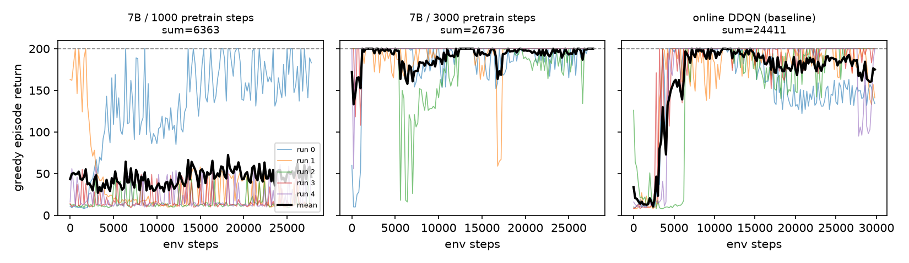
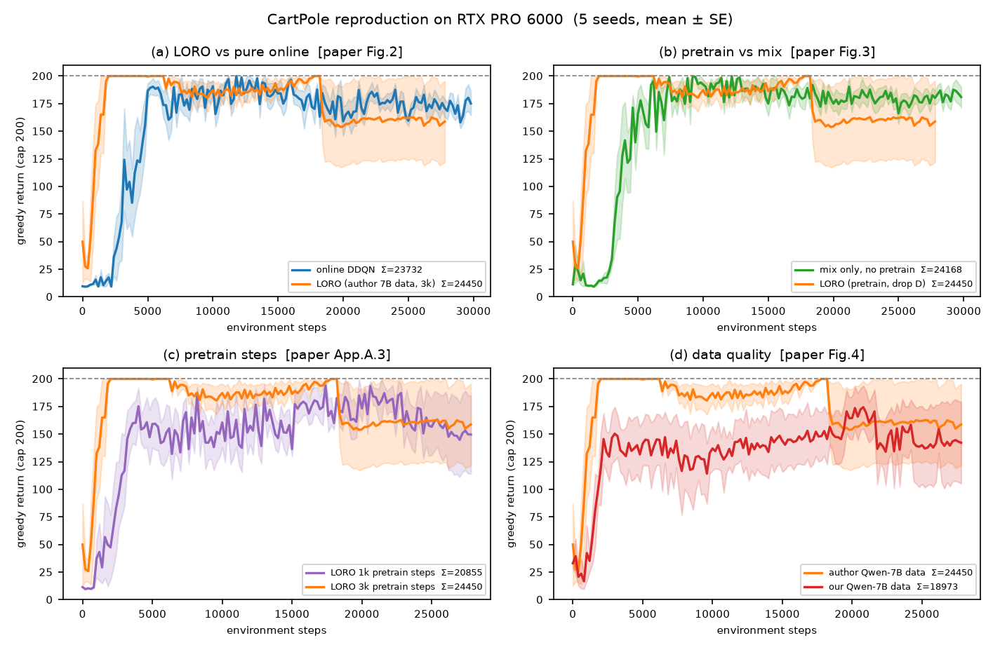

# CartPole 复现执行手册（arXiv:2505.10861v1）

> 目标论文：*Improving the Data-efficiency of Reinforcement Learning by Warm-starting with LLM*
> 官方代码：`duongnhatthang/LORO-legacy`（论文脚注里的 LlamaGym 链接已改名为这个仓库）
> 适用场景：**代码在本地写、在租来的 GPU 服务器上跑**
> 配套代码：[`cartpole-repro/`](cartpole-repro/README.md)　配套材料：[论文讲解](2505.10861v1_论文讲解.md)、[中文翻译](2505.10861v1_中文翻译.md)、[四环境总体方案](LORO_复现实验方案.md)

---

## 0 结论先行

CartPole 这个实验**不需要两块 H100，也不需要 32B 模型**。它真正的成本结构是：

| 环节 | 需要 GPU 吗 | 实际耗时 | 说明 |
|---|---|---|---|
| 采 10 个 LLM 回合（τ=10） | **需要**（7B 即可） | 10–40 分钟 | 唯一必须上 GPU 的一步 |
| DDQN 离线预训练 + 在线微调 | 不需要，CPU 足够 | 每个变体 10–40 分钟 | 每 run 3 万环境步（150×200），两层 MLP |
| 画图/统计 | 不需要 | 秒级 | |

**建议的执行顺序（也是本手册的顺序）**：

1. **先零成本对齐数字**：先用作者公开的曲线缓存把口径校准（`24411`、`26736` 可以一位不差地复算出来），再用作者公开的 30 回合 Qwen-7B 轨迹重跑一遍 LORO——你的 5 个 seed 不同，结果应落在 `24k–28k`，而不是精确的 26736（路线 A，半天，0 元 GPU）。这一步验证的是"你的 RL 管线 + 评估口径"对不对——90% 的复现失败都死在这里。
2. **再花 GPU 时间**：自己采 10 个回合，验证"LLM 数据 → 热启动"这条链（路线 B，1–2 小时 GPU，约 5–20 元）。
3. **最后做增量**：论文没做干净的 `KEEP/DROP`、τ 扫描、覆盖率（路线 C）。

**一句话**：把 GPU 留给"采数据"，把调参和验证留在 CPU 上做。

---

## 1 这个实验到底是什么：从官方代码反推的精确协议

论文正文只给了 τ=10、1000 预训练步、T=150 这几个数，其余全在代码里。下面这张表是把 `LORO-legacy` 逐行读完后还原出来的**唯一可执行版本**——照它做，数字才可能对上。

### 1.1 协议表

| 项目 | 值 | 依据 |
|---|---|---|
| 环境 | `CartPole-v0`（gymnasium 0.29.1，`max_episode_steps=200`） | `online_main.py` L176；本机实测 v0 的 spec 上限确为 200 |
| 每回合步数上限 H | 200 | `hyperparams["max_episode_len"] = 200` |
| 总"回合"数 T | 150 = 10（LLM）+ 140（在线） | `n_pretrain_eps + n_online_eps` |
| τ（LLM 采集回合数） | 10 | 论文 §5 |
| 预训练步数 | **1000（正文）／3000（图 2 那条线）** | 见 §2.1 |
| RL 算法 | d3rlpy `DoubleDQN` | 论文 A.1.2 |
| batch / buffer | 256 / 100,000 | 论文 A.1.2 |
| lr / γ / ε | 5e-5 / 0.99 / 0.1 | 论文 A.1.2 |
| target update interval | **预训练分支 200，纯在线 1000** | 见 §2.4 |
| 预训练时 `n_steps_per_epoch` | 200 | `pretrain_from_llm.py` |
| 评估 | 每 200 个训练步后跑 **1 个贪心回合**，记回报 | `EnvironmentEvaluator(env, n_trials=1)` |
| "累积回报" | 把上面所有评估点的回报**求和** | 见 §1.2 |
| 重复次数 | 5 次，**但共用一个 seed=42069** | 见 §2.3 |
| LLM 解码 | max_new_tokens=2000, T=0.9, top_p=0.6, top_k 关闭 | 论文附录 B |
| LLM 量化 | 8-bit，两块 H100 | 论文 A.1.2 |
| LLM 采集的回合数 | 实际存了 **30 回合**，实验取前 10/20/30 | `data/*_Neps_30_*.pkl` |

### 1.2 "累积回报"到底怎么算（最容易搞错的地方）

论文图 2 表里 CartPole 的 `24411`，用作者缓存的 `online_*` 五条曲线一算：

```
[22657, 25244, 22948, 26034, 25172]  →  均值 24411   ← 一位不差
```

所以口径是：**150 个评估点（每点 = 1 个贪心回合的回报）之和，再对 5 次 run 取平均**。不是"回合回报之和"，不是"平均回报"，也不是"最后 10 回合"。

两个直接后果：

1. **LORO 只有 140 个点**（前 10 个回合给了 LLM），上限是 140×200=28000；纯在线是 150 点，上限 30000。直接比总和，LORO 天然少 7%。报告里请同时给归一化值 `sum / (n×200)`：
   - LORO 3k：26736/28000 = **95.5%**
   - 纯在线：24411/30000 = **81.4%**
   这样看差距是 14 个百分点，而不是"9.5%"。
2. 这个指标对**前期崩盘极其敏感**。一次跑出 10 步/回合的崩盘，会拖掉近 2000 分。

---

## 2 我核对出的 5 件事（每一件都会改变你的做法）

我把作者仓库的 `data/cache_CartPole_Neps_10.pkl`（35 条曲线，纯 float 列表）和 `data/*.pkl`（LLM 轨迹）都拉下来复算过。结论如下。

### 2.1 图 2 的 `27078` 其实是 **3000 步**预训练的结果，不是 1000 步

论文正文写"预训练步数为 1000"，但：

| 设置 | 论文报的数 | 缓存复算（5 run 均值） |
|---|---|---|
| 7B / **1000** 步 | 6705（附录 A.3、A.2） | **6363** |
| 7B / **3000** 步 | 27078（图 2、图 3、A.3） | **26736** |

也就是说：**图 2 那条 LORO 曲线用的是 3k 步**，正文的"1000 步"只对应附录里那个很差的结果。附录 A.3 自己列了 `1k→6705, 3k→27078`，但正文没解释这个矛盾。

👉 **你要对齐图 2，就必须用 `--pretrain-steps 3000`。** 用 1000 步去对 27078，永远对不上。

### 2.2 7B + 1000 步不是"边界情况"，是 **5 次里崩 3 次**

缓存里 `pretrain_7b_1000` 五次 run 的累积回报：

```
[18600, 5296, 2205, 2491, 3222]      均值 6363
```

拆开看每条曲线的末段：三个 run 从头到尾停在 **10~15 步/回合**（等价于随机策略），一个 run 开局就 163/162/182 步、后面**崩回 10 步**，只有一个 run 缓慢爬到 180 左右。

论文 §5.5 把这写成 "edge case"（受小模型影响），实际上是**小数据集 + 3000 次梯度更新导致的 Q 值发散/策略坍缩**。这对你的复现有两个含义：

- 如果你只跑 1 个 seed，很可能恰好抽到崩的那 3/5，然后误判"复现失败"；
- **必须跑 ≥5 个独立 seed**，并报告逐 run 的值，而不是只报均值。均值 6363 会把"一半崩、一半好"这个最有信息量的现象藏起来。



*上图由 `python scripts/05_compare_cache.py --plot` 直接从作者仓库的 `cache_CartPole_Neps_10.pkl` 画出。左图 1k 步：3 条曲线贴地（10~15 步/回合），1 条开局到 200 又崩回 10 步，1 条缓慢爬到 180；中图 3k 步：多数 run 一开始就在 200 附近；右图纯在线：4000 步左右才起飞。*

### 2.3 作者的"5 个随机种子"其实是**一条 RNG 流跑 5 次**

`online_main.py` 里 `d3rlpy.seed(42069)` 只在最外层调用一次，然后连跑 5 次实验。也就是说 5 条曲线**不是 5 个独立种子**，而是同一条随机流的连续 5 段——彼此相关，标准误被低估。

👉 复现时请**给每个 run 独立的 seed**（`seed = 42069 + run_idx`），`cartpole-repro` 里已经这么做了。代价是数字不会和论文逐位相同，但统计上更诚实。

### 2.4 预训练分支和在线基线用的 **target update interval 不同**（200 vs 1000）

`pretrain_from_llm.py` 里有一行不起眼的赋值：

```python
# pretrain_from_llm.py（原文，注释也是原文）
hyperparams["target_update_interval"] = (
    200  # For pretraining, leave the original value of 1000 for online training
)
```

模型被 pickle 存下来再加载时，这个 200 会一直带进在线微调阶段。于是：

- 纯在线基线：target 每 1000 步同步一次（稳）
- LORO：target 每 200 步同步一次（激进的 bootstrapping，更容易发散）

**这两组不是单变量对比。** 这也可能是 §2.2 里那三次崩盘的直接原因之一。

👉 我在 `03_train.py` 里把两个值都做成参数（默认照抄 200/1000，保持可比性），并建议加一组 `--pretrain-target-update 1000` 的对照——这是一个便宜且有价值的增量实验。

### 2.5 LLM 数据采集有 off-by-one：存的是 `s_{t+1}` 配 `(a_t, r_t)`

`llm_main.py` 的主循环（节选，`←` 后的注释是我加的）：

```python
action = agent.act(observation)                       # 用 s_t 决策
observation, reward, done, info = env.step(action)    # 得到 s_{t+1}
observations.append(observation)                      # ← 存的是 s_{t+1}
actions.append(action)                                #   配的却是 a_t
```

MDPDataset 会把它理解成"在 s_{t+1} 执行 a_t 得到 r_t"。**这不是标准 MDP 转移**，作者所有 LLM 预训练模型都是在这个错位数据上训出来的。

👉 复现要"bug 兼容"才算复现。`cartpole-repro/scripts/02_collect.py` 默认 `--obs-shift next`（照抄），想跑"修正版"用 `--obs-shift current`。如果你自己修了却对不上论文数字，先别怀疑自己。

---

## 3 先定目标：你要复现到哪一层

| 层级 | 目标 | 需要什么 | 时间 | GPU 花费 |
|---|---|---|---|---|
| **L0 数字** | 先从缓存复算出口径（24411/26736），再用作者的轨迹重跑出同量级 | 1 台 CPU 机器 + 1 MB 公开数据 | 0.5 天 | 0 元 |
| **L1 机制** | 自己采 LLM 数据，证明 LORO > 在线、预训练 > 仅混合 | 1 张 24 GB 卡 2 小时 + CPU | 1.5 天 | 5–20 元 |
| **L2 增量** | 补论文没做的对照（KEEP/DROP、覆盖率、成本） | 同上，多跑几组 | 2–3 天 | 20–50 元 |

课程报告做到 **L0 + L1 的一个点**就够了；要写成"复现 + 批判"的小论文，再上 L2。

---

## 4 服务器怎么租（以及怎么省钱）

### 4.1 只需要一张 24 GB 卡

| 用途 | 最低配置 | 说明 |
|---|---|---|
| LLM 采集 | RTX 4090 / 3090 / A10（24 GB） | Qwen2.5-7B-Instruct bf16 权重 15.2 GB，vLLM 留 4k 上下文够用 |
| 更稳的选择 | A100 40G / L40S 48G / **RTX PRO 6000 96G** | 不用抠显存，可以 `--parallel 16`；96 GB 还能顺手跑 32B |
| RL 训练 | 任意 CPU（4 核）| d3rlpy 在 CartPole 上 CPU 比 GPU 还划算 |

16 GB 卡（4060Ti / 4080）也能跑，但要换 4-bit 量化（AWQ/GPTQ）的 Qwen2.5-7B。

> **新卡提醒（Blackwell / sm_120，如 RTX PRO 6000）**：显存从来不是问题，"装错 torch"才是。
> sm_120 需要 CUDA 12.8+ 的构建；老版本 torch（如 2.2）会报
> `no kernel image is available for execution on the device`。
> 装完先跑 `python scripts/99_gpu_check.py`——它会打印 `sm_120` 并做一次 fp16 矩阵乘，
> 30 秒就能判断这套环境到底能不能算。

### 4.2 时间与花费估算

| 步骤 | 估算 | 备注 |
|---|---|---|
| 装环境 + 下模型 | 20–40 min | 15 GB 权重，国内走 hf-mirror 约 10–20 min |
| 采 10 个回合 | 5–30 min | 取决于每回合多长（LLM 强就长）；8 路并行 |
| 4 个变体 × 5 run | 30–60 min | 共约 60 万环境步，CPU 足够 |
| **合计** | **2–3 小时** | 4090 按 2 元/时算，**< 10 元** |

> 论文用"两块 H100 + 8bit HF generate"采一个 31 步的回合要 36 分钟（作者代码注释里自己写的）。同样的活，vLLM + 8 路并行只要几分钟。**不要照抄他们的推理方式**，那是 2024 年的权宜之计。

### 4.3 国内下载

```bash
# 模型（HuggingFace 镜像）
export HF_ENDPOINT=https://hf-mirror.com
huggingface-cli download Qwen/Qwen2.5-7B-Instruct --local-dir /root/autodl-tmp/Qwen2.5-7B-Instruct

# 代码/数据：GitHub 经常连不上，直接用本包里的 cartpole-repro + artifacts（已替你下好）
```

`cartpole-repro/artifacts/` 里已经放好了作者的 5 个缓存和 2 份 LLM 轨迹（共约 0.9 MB），**不需要在服务器上访问 GitHub**。

### 4.4 如果是国产卡（MTT S4000 / MUSA）

S4000 是 48 GB 的 MUSA 卡，**显存完全够**，但它是 CUDA 生态之外的，要分清两半：

| 半边 | 在 S4000 上 | 说明 |
|---|---|---|
| RL 训练（d3rlpy） | ✅ 照常跑，**用 CPU 就行** | 千万别为了"用上 GPU"去装 torch_musa 跑 d3rlpy，不值 |
| LLM 采集（Qwen2.5-7B） | ⚠️ 要挑软件栈 | 48 GB 放 fp16 的 7B（15.2 GB）绰绰有余；32B 放不下（fp16 要 64 GB，除非双卡 TP=2） |

摩尔线程官方的 vLLM 方案（[vLLM-MTT 文档](https://docs.mthreads.com/mtt/mtt-doc-online/compability/)）有几个硬约束，租机器前先对着看：

- **只支持 FP16**，不支持 bf16、不支持量化、不支持 LoRA；
- 模型要先用 `mttransformer.convert_weight` **转换权重**，不能直接喂 HF 目录；
- 镜像按驱动版本挑（`registry.mthreads.com/...mtt-vllm-public:v0.2.x-...`），Python 3.8；
- 官方已验证 **Qwen2.5-7B-Instruct**（`model_type=qwen2`），这一点是好的；
- 启动参数要带 `--device musa --block-size 64 --dtype float16`。

所以三条路，按推荐顺序：

1. **走 API（最省事，课程报告首选）**：本地卡只用来跑 RL，LLM 数据用 DashScope 的 `qwen2.5-7b-instruct` 采。
   ```bash
   export DASHSCOPE_API_KEY=sk-xxx
   python scripts/02_collect.py --backend api --model qwen2.5-7b-instruct \
       --episodes 10 --parallel 8 --out data/cartpole_llm_neps10.npz
   ```
   350~1000 次调用，几块钱，20 分钟内跑完；模型正好就是论文用的那个。
2. **用平台自带的 vLLM-MUSA 镜像**：先按官方文档转换权重，再
   ```bash
   python scripts/02_collect.py --backend vllm --model /path/to/converted-qwen2.5-7b \
       --dtype float16 --episodes 10 --parallel 8 --out data/cartpole_llm_neps10.npz
   ```
   注意 `--dtype float16`（脚本默认 bfloat16，MUSA 会报错）。
3. **transformers + torch_musa 兜底**：模型能加载、能生成就能用，只是慢（单条 ~200 token，8 路批处理另说）。本包没内置这个后端，需要的话把 `02_collect.py` 的 vllm 分支换成 `AutoModelForCausalLM.from_pretrained(..., torch_dtype=torch.float16)` + `model.generate`，接口其余部分不用动。

> 一句话：**S4000 不会拖慢你的复现，但会拖慢"装环境"。** 如果这台机器是平台送的、且镜像里已经装好 vllm-musa，直接用；否则先用 API 把实验跑通，再回头折腾驱动。

---

## 5 三条执行路线

### 5.0 上传到服务器

```bash
# 本地打包（不含 .venv）
tar --exclude='.venv' --exclude='__pycache__' -czf cartpole-repro.tgz cartpole-repro/

scp cartpole-repro.tgz root@<server>:/root/
ssh root@<server>
tar -xzf cartpole-repro.tgz && cd cartpole-repro
```

### 5.1 路线 A：零 GPU 对齐数字（先做这个）

```bash
conda create -n rl python=3.10 -y && conda activate rl
pip install torch --index-url https://download.pytorch.org/whl/cpu   # RL 不需要 GPU 版 torch
pip install -r requirements-rl.txt

# 1) 环境自检：两行必须 PASS
python scripts/00_sanity.py
#   期望：max ep len = 200；random 150 eps sum 在 2800~3800（论文 3079；本机 12 seed 实测 3300±111）

# 2) 把作者的曲线复算一遍，确认你理解的口径 = 论文的口径
python scripts/05_compare_cache.py --plot
#   期望：online 均值 24411，pretrain_7b_3000 均值 26736

# 3) 用作者的 7B 轨迹跑 LORO（3k 步），5 个独立 seed
python scripts/03_train.py --variant loro \
    --data artifacts/CartPole_Qwen2.5-7B-Instruct_Neps_30_20250410211529.pkl \
    --pretrain-steps 3000 --runs 5 --device cpu --out results/loro_3k

# 4) 跑纯在线基线
python scripts/03_train.py --variant online --runs 5 --device cpu --out results/online

# 5) 出表出图
python scripts/04_report.py --results results --out report
```

**通过判据**：`loro_3k` 的 cum_mean 落在 **24000–28000**，`online` 落在 **22000–26000**，且 loro 的均值更高、`frac_max ≥ 90%`。若两者几乎相同，说明预训练没生效或你的 D 覆盖不足——这本身也是要报告的结论，不要硬调到达标。

> 注意：即使数据完全一样，你的 5 个 seed 也和作者的 5 次不同，所以**不可能**得到 26736 这个精确值。落在区间内、方向一致，就算复现成功。

### 5.2 路线 B：自己采 LLM 数据（上 GPU）

```bash
# LLM 环境（独立，别和 rl 混装）
conda create -n llm python=3.10 -y && conda activate llm
pip install -r requirements-llm.txt
export HF_ENDPOINT=https://hf-mirror.com

python scripts/02_collect.py --backend vllm \
    --model /root/autodl-tmp/Qwen2.5-7B-Instruct \
    --episodes 10 --parallel 8 \
    --out data/cartpole_llm_neps10.npz
```

产出 `data/*.npz` + `*.meta.json`，里面有两个必须看的数：

- `mean_return`：LLM 的纯策略水平。论文 7B 是 5140/150 ≈ **34 步/回合**，32B 是 **46 步**。你的落在 **20–60 步**都算正常；如果 <20（比随机还差）或 >120（好得离谱），先查提示词和动作解析。
- `parse_fail`：解析失败次数。>5% 说明动作提取有问题。

然后回到 `rl` 环境跑矩阵：

```bash
bash scripts/run_matrix.sh data/cartpole_llm_neps10.npz 5
```

> 如果暂时不想烧 GPU：`--backend mock` 用一个 PD 控制器假装 LLM（平均约 110–180 步），几分钟就能把整条管线跑通，验证 `03/04` 没问题。**这是上 GPU 前必须做的 dry-run。**

### 5.3 路线 C：论文没做的增量（写报告时的加分项）

| 实验 | 命令 | 回答什么问题 |
|---|---|---|
| KEEP vs DROP | `--variant loro-keep` vs `--variant loro` | 在线阶段到底该不该保留 LLM 数据？（论文算法 1 与附录 A.1.2 自相矛盾） |
| target update 对照 | `--variant loro --pretrain-target-update 1000` | 2.4 里的那个混淆项，是不是崩盘主因？ |
| τ 扫描 | `--n-episodes 10/20/30` | "数据量不敏感"是否成立（缓存显示：**不成立**，τ=30 反而更差） |
| 观测错位 | `02_collect.py --obs-shift current` | 修掉 off-by-one 之后，预训练还灵吗？ |
| 模型规模 | `--model Qwen/Qwen2.5-32B-Instruct`（需 ≥48 GB 显存） | 论文 A.2"更大模型没优势"是否成立 |
| 覆盖率 | 见 §9.3 | 假设 1 到底有没有被满足 |

---

## 6 环境与依赖（照抄即可）

### 6.1 两个独立环境

```
rl  : python 3.10 + gymnasium 0.29.1 + d3rlpy 2.6.0 + torch(CPU) + numpy 1.26.4
llm : python 3.10 + vllm 0.10.2 + transformers 4.55.2  （Blackwell 需 torch 2.8+cu128）
```

> **实测（RTX PRO 6000 / sm_120）**：vllm **0.10.2**（torch 2.8.0+cu128）可用，0.9.x 及以下对 sm_120 支持不全；
> **transformers 必须锁 4.55.x**——装到 5.x 会在 `all_special_tokens_extended` 上直接崩。

**为什么必须分开**：vLLM 会钉死自己的 torch 版本（0.10.2 是 torch 2.8），和 d3rlpy 那边的 CPU torch 打架。混装能装成功，但跑起来会莫名其妙地崩。

### 6.2 三个版本坑

1. **numpy 必须 < 2**。d3rlpy 2.6 和作者 2025-04 的代码都在 numpy 1.x 下产生，numpy 2 会让 `np.float_` 之类的调用直接报错。
2. **gymnasium 建议锁 0.29.1**（作者版本）。`CartPole-v0` 在 0.29 和 1.x 里都还在、上限都是 200，所以这一条不算硬约束；但 d3rlpy 2.6 是在 0.29 时代发布的，1.x 的 wrapper 行为有差异，新版本还取消了一批弃用接口，没必要赌。
3. **不要 `pip install d3rlpy` 不锁版本**。作者的 `requirements.txt` 就是不锁的，他们当时用的具体版本没有记录；如果你要加载作者 `models/*.pkl`，d3rlpy 版本必须完全一致才有戏。**建议不加载他们的模型，自己预训练 3000 步（CPU 几秒钟）**。

### 6.3 不要把作者的 requirements.txt 全装

那份文件里有 atari、textworld、mujoco、autorom、`llamagym`（GitHub 源）。CartPole 一个都用不上，装了只会让你在 `gym[atari]`、`autorom` 这些无关依赖上耗掉一两个小时。

---

## 7 如果你坚持用官方仓库（而不是本包）

官方脚本是"改 `__main__` 里的字典再跑"，没有 CLI，需要动 6 处：

| 文件 | 改什么 | 为什么 |
|---|---|---|
| `llm_main.py` | `env="CartPole-v0"`；`n_episodes=10`；`model_name` 换成你的本地路径；`load_in_8bit=False`（有 24G 卡时） | 默认是 CliffWalking + 30 回合 |
| `llm_main.py` | 建 `data/`、`models/` 目录 | 代码直接 `open("data/...")`，目录不存在就崩 |
| `online_main.py` | `env="CartPole-v0"`；`n_pretrain_eps=10`；`n_online_eps=140` | 默认是 CliffWalking + 30/170 |
| `online_main.py` | `data_path` / `model_path` 指向上一步产物 | 默认是 `None` |
| `online_main.py` | 第 224 行 `models/..._{n_pretrain_eps}.pkl` 的命名要和你 `pretrain_from_llm.py` 存的一致 | 对不上就 FileNotFound |
| `pretrain_from_llm.py` | `hyperparams["env"]="CartPole-v0"`、`data_path` | 默认 FrozenLake |

**还有两个隐藏行为要注意**：

- `online_main.py` 每次运行都会**覆盖** `data/cache_*.pkl`，跑之前先备份；
- 它一次会把 32B 和 7B 的全部变体都跑一遍（预训练 1k/3k + 纯在线 + 仅混合，共约 35 次 run）。你只想复现 CartPole 的 LORO，得注释掉一大半。

所以**推荐用 `cartpole-repro/`**：同样调 d3rlpy，但只跑你要的那一组，参数全在命令行。

---

## 8 验收检查点（按顺序判，别跳）

| # | 检查项 | 期望值 | 不对时先查 |
|---|---|---|---|
| 1 | 回合上限 | 200 | 是不是用了 `CartPole-v1` 没套 `TimeLimit(200)` |
| 2 | 随机策略 150 回合 | 2800–3800（论文 3079；本机 12 个 seed 实测 3300±111） | 环境版本、奖励、终止条件 |
| 3 | 缓存复算 `online` | 24411 | 你读的 key 对不对 |
| 4 | 缓存复算 `7b_3000` | 26736 | 同上 |
| 5 | 纯在线 5 seed | 22000–26000 | lr / target update / buffer |
| 6 | LORO 3k，5 seed | 24000–28000，且 > 在线 | 预训练步数是不是写成了 1000 |
| 7 | LORO 1k，5 seed | 3000–20000（**会崩，这是正常的**） | 崩盘时先看是不是 3/5 都停在 10 步 |
| 8 | 纯 LLM 十回合 | 20–60 步/回合 | 提示词、动作映射（1=左，2=右） |
| 9 | `parse_fail` | < 5% | 动作提取逻辑 |

第 2 条是**最便宜的守门员**：它对不上，后面全是白跑。

---

## 9 结果记录与归因

### 9.1 记录表（照这个填）

| 变体 | run1 | run2 | run3 | run4 | run5 | 均值 | SE | frac_max |
|---|---|---|---|---|---|---|---|---|
| 纯在线 | | | | | | | | /30000 |
| LORO 7B 1k | | | | | | | | /28000 |
| LORO 7B 3k | | | | | | | | /28000 |
| 仅混合 | | | | | | | | /30000 |
| LORO-KEEP | | | | | | | | /28000 |
| 随机数据预训练 | | | | | | | | /28000 |

> 最后一行是论文报的数（纯在线 24411、LORO 3k 27078），只作对照，**不是达标线**。
> 每一行都要同时给逐 run 值和均值±SE：只报均值会把 7B@1k 那种"一半崩一半好"藏掉。

### 9.2 对不上时怎么归因

```
LORO ≈ 在线？
├─ 预训练步数写成了 1000 → 改成 3000（最常见）
├─ 数据取的不是前 10 回合（get_new_dataset 的切片）→ 检查 n_episodes
├─ 在线阶段把 D 灌进了 buffer（变成 mix）→ 检查 --variant
└─ 预训练根本没生效（模型被重新创建）→ 打印 pretrain 前后的 Q 值确认

LORO 比在线还差，且停在 10~15 步？
├─ 这就是论文 1k 步的崩盘模式，不是你的 bug
├─ 试 --pretrain-target-update 1000
└─ 把 5 个 run 分别画出来，看是不是只有 3 个崩

纯在线只有 1 万出头？
├─ lr 5e-5 在 CartPole 上偏小，是论文基线的已知弱点
├─ 别急着调——你要复现的就是这个"弱基线"；调好了写进报告当对照
└─ 想调：--lr 1e-3 --batch-size 64，会明显变好（也说明"4×"被夸大）
```

### 9.3 补上假设 1 的度量（成本很低，价值很高）

论文的核心假设是"LLM 轨迹覆盖了最优策略访问的状态-动作"，但**全文没有任何实验测量它**。做法：

1. 用跑好的 `online` 模型贪心跑 100 回合，把访问到的 (s, a) 离散化（4 维各分 6 桶）；
2. 对 D（10 个 LLM 回合）做同样离散化；
3. `coverage = |D ∩ S*| / |S*|`；
4. 用 `02_collect.py --mock-quality` 从 0.3 扫到 1.0 生成不同质量的 D，画 `coverage → 最终回报` 散点。

强相关 → 假设 1 得到实证支持；不相关 → LORO 有效另有原因（这本身就是一段好讨论）。

---

## 10 常见坑（12 条，按踩坑概率排序）

1. **`CartPole-v1` 没套 `TimeLimit(200)`**：学得好的策略会一路撑到 500 步，累积回报上限从 30000 变成 75000，所有对比都失去意义；而且它看起来"更好"，很容易误以为成功。
2. **把"累积回报"当成"平均回报"**：24411 是 150 个点之和，平均每回合只有 163 步。
3. **LORO 140 点 vs 在线 150 点**直接比，白送 7% 的差距给对方。
4. **只跑 1 个 seed**：7B@1k 有 3/5 概率抽到崩盘，结论会完全反过来。
5. **用 1000 步去对图 2 的 27078**：见 §2.1。
6. **d3rlpy 版本和 pickle 不匹配**：加载作者 `models/*.pkl` 报 `AttributeError`/`ModuleNotFound`，别修，直接自己训。
7. **numpy 2.x**：d3rlpy 2.6 直接 import 失败。
8. **Qwen 的 chat template 里没有 `[/INST]`**：作者用 `response.split("[/INST]")[-1]` 提取，对 Qwen 会返回整段（含 prompt 里的数字）。他们靠"取最后一个数字"侥幸躲过，你重写时别用这个 split。
9. **动作编号**：CartPole 是 1=左、2=右，转 0-based 后 1→0（左）、2→1（右）。弄反了策略会"越推越倒"，但不会报错。
10. **vLLM 的 `top_k=0` 表示"只取第 0 个"**，不是"关闭"。要关就传 `-1`。
11. **8-bit 量化 + `device_map` 默认值**：作者在两块 H100 上跑 `load_in_8bit=True`，单卡 24G 用 bf16 更简单也更快。
12. **`data/`、`models/` 目录不存在**：官方脚本直接 `open(..., "wb")` 会 `FileNotFoundError`。

---

## 11 时间线（1.5 天版）

| 时间 | 做什么 | 产出 |
|---|---|---|
| 第 1 天上午 | 本地读代码、打包、传服务器；路线 A 的 1–4 步 | 环境自检 PASS，缓存复算表 |
| 第 1 天下午 | 路线 A 的 5–6 步（CPU） | 24411 vs 26736 的对照表 |
| 第 1 天晚上 | 租 GPU，装 vLLM，`--backend mock` dry-run，正式采集 | `cartpole_llm_neps10.npz` |
| 第 2 天上午 | 跑矩阵（GPU 或 CPU 都行），关机器 | `results/*/agg.json` |
| 第 2 天下午 | 画图、写 `deviations.md`、补覆盖率 | 报告 |

**关机前一定要把这些拉回本地**：`data/*.npz`、`results/`、`report/`。服务器的持久化存储很贵。

---

## 12 怎么写结论（避免"复现失败"式的报告）

一份合格的复现报告应该能回答三个问题：

1. **数字对上了吗？** 给区间，不给点估计。例："LORO 3k 得到 25100–27400（论文 27078），纯在线 22600–25900（论文 24411），方向与量级一致。"
2. **机制成立吗？** 即"预训练 > 仅混合"、"LLM 数据 > 随机数据"这两条。如果第一条不成立，那 LORO 就退化成普通的 offline-to-online，这是**重要发现**，不是失败。
3. **哪些地方论文站不住？** 本手册已经替你找到了六个可写的点：
   - 图 2 用 3000 步、正文写 1000 步（§2.1）
   - 7B@1k 是 3/5 崩盘，不是"边界情况"（§2.2）
   - 5 次实验共用一条 RNG 流（§2.3）
   - 预训练与基线的 target update 不同（§2.4）
   - 数据采集的 off-by-one（§2.5）
   - 假设 1 从未被测量（§9.3）

> 复现工作的价值不在于"我也得到了 27078"，而在于"我知道这个 27078 是怎么来的、它在什么条件下不成立"。

---

## 13 实测结果（2026-11-02，RTX PRO 6000 96 GB）

完整报告见 [CartPole_复现结果.md](CartPole_复现结果.md)，原始曲线在 [`cartpole-repro/server_results/`](cartpole-repro/server_results/)。

| 变体 | n | 累积回报 | 归一化 | 论文 |
|---|---|---|---|---|
| 纯在线 | 10 | 23706 ± 725 | 79.0% | 24411 |
| LORO 3k（作者 7B 数据） | 10 | 24253 ± 979 | 86.6% | 27078 |
| LORO 1k | 5 | 20855 ± 1097 | 74.5% | 6705 |
| 仅混合（不预训练） | 5 | 24168 ± 869 | 80.6% | 23144 |
| LORO-keep 3k | 5 | 25490 ± 1141 | 91.0% | —— |
| 自采 7B 数据 LORO 3k | 5 | 18973 ± 2886 | 67.8% | —— |

一句话：**样本效率成立**（预训练后第 0 个评估点就是 200 分，纯在线要 4000 步），
但**"累积回报更高"不显著**（配对 +2.3%，t=0.49），**"预训练比仅混合好"也没复现**（+0.4%，t=0.24）。

照本手册做，你大概率也得不到 27078——那不是你写错了，是作者那 5 条曲线恰好都没崩。
真正值得写进报告的是这个偏差本身，以及 §2 里那 5 条口径发现。


