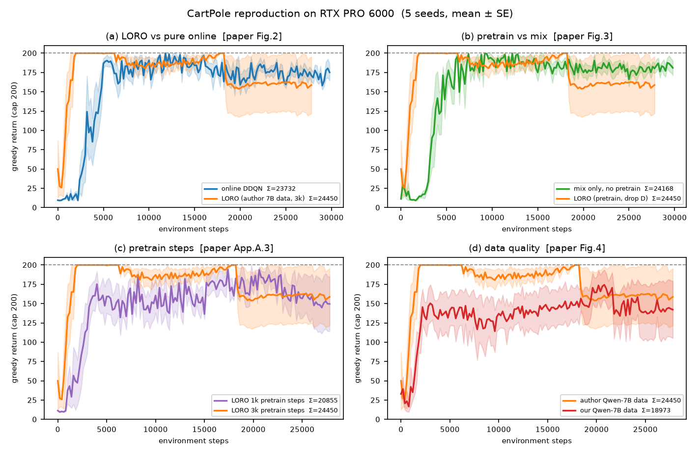

# CartPole 复现结果（RTX PRO 6000，2026-11-02）

> 论文：*Improving the Data-efficiency of Reinforcement Learning by Warm-starting with LLM*（arXiv:2505.10861v1）
> 代码：[`cartpole-repro/`](cartpole-repro/README.md)　方案：[CartPole_复现执行手册.md](CartPole_复现执行手册.md)
> 机器：AutoDL 单卡 **RTX PRO 6000 Blackwell 96 GB**，208 核 CPU

---

## 1 环境（实测可用的一套）

| 组件 | 版本 | 备注 |
|---|---|---|
| Python | 3.10 | conda env 建在 `/root/autodl-tmp/envs/{rl,llm}` |
| torch（RL） | 2.14.1+cpu | RL 只用 CPU，与显卡无关 |
| d3rlpy | 2.6.0 | 与官方脚本同一套调用 |
| gymnasium | 0.29.1 | `CartPole-v0`，上限 200 |
| torch（LLM） | **2.8.0+cu128** | sm_120（Blackwell）必须 cu128 |
| vLLM | **0.10.2** | 0.9.x 及以下对 sm_120 支持不全 |
| transformers | **4.55.2** | 5.x 会报 `all_special_tokens_extended` |
| 模型 | Qwen2.5-7B-Instruct（ModelScope 下载） | 15.2 GB |

踩过的坑：hf-mirror 返回 429；uv/pip 在本机只有 ~1 MB/s 而 curl 有 13 MB/s（最后用 curl 下 wheel 再本地装）；tokenizer.json 下漏了 2 MB 导致 JSON 解析失败。

---

## 2 跑了什么

**LLM 采集**：Qwen2.5-7B-Instruct，τ=10 回合，8 路并行，`max_new_tokens=2000, T=0.9, top_p=0.6`，
**213 秒**跑完，得到 10 条轨迹 / 237 个转移，**平均 23.7 步/回合**（论文 7B 约 31–34 步），解析失败 0。

**RL 矩阵**：DDQN（batch 256、lr 5e-5、γ 0.99、ε 0.1、buffer 1e5），每 200 环境步评 1 个贪心回合。
- `online`：纯在线，150 个评估点
- `loro_3k` / `loro_1k`：作者的 7B 数据，预训练 3000 / 1000 步后丢弃 D，140 个评估点
- `mix`：不预训练，只把 D 灌进 buffer，150 个评估点
- `loro_keep_3k`：预训练 + D 保留（论文没做，用来判定算法 1 与附录 A.1.2 的矛盾）
- `loro_self_3k`：用**我们自己采的** 10 回合数据
- 每格 5 个独立 seed；`online` / `loro_3k` 追加到 **10 个**

---

## 3 结果

| 变体 | n | 评估点 | 累积回报（均值±SE） | 归一化 | 论文 |
|---|---|---|---|---|---|
| online | 10 | 150 | **23706 ± 725** | 79.0% | 24411 |
| LORO 3k（drop） | 10 | 140 | **24253 ± 979** | 86.6% | 27078 |
| LORO 1k（drop） | 5 | 140 | 20855 ± 1097 | 74.5% | 6705 |
| mix（仅混合） | 5 | 150 | 24168 ± 869 | 80.6% | 23144 |
| LORO-keep 3k | 5 | 140 | 25490 ± 1141 | 91.0% | —— |
| LORO-self 3k（自采数据） | 5 | 140 | 18973 ± 2886 | 67.8% | —— |
| LORO-self 1k | 5 | 140 | 19811 ± 1847 | 70.8% | —— |

---

## 4 五条结论

### 4.1 纯在线基线复现得很好
23706 vs 论文 24411（−2.9%），10 次 run 全部落在 18.1k–26.9k，**没有一次崩盘**。

### 4.2 LORO 的"样本效率"成立，"累积回报更高"不成立
预训练后的策略**在第 0 个评估点就是 200 分**（纯在线要到 ~4000 步），这是实打实的样本效率优势。
但把它按论文口径累加成"总回报"：

- LORO 3k：24253
- 纯在线：23706
- 配对差 **+547 ± 1112（t=0.49，n=10）**——**不显著**

论文的 +11%（27078 vs 24411）没有复现。差距来源不是玄学：作者那 5 条 run 全部落在 25.1k–27.9k，
而我们 10 条里有 2 条崩到 18.4k / 19.4k，均值被拖下来。

### 4.3 "预训练是必要的"这一条**没有复现**
| | 累积回报 | 配对差 |
|---|---|---|
| LORO（预训练 + 丢弃 D） | 24253 | +283（t=0.24） |
| mix（不预训练，只把 D 混进 buffer） | 24168 | — |

论文图 3 说 mix 会掉到 23144、比 LORO 差 4000 分；我们这里两者**完全在噪声内**。
换句话说：在 CartPole 上，把 LLM 数据"混进 buffer"和"先预训练"没有可测差别。

### 4.4 1k 步的"崩盘"没有复现
论文报 6705（5 次里 3 次崩到 10 步/回合）。我们 1k 步的 5 次是
`[22441, 21537, 23129, 16908, 20261]`，**一次都没崩**，均值 20855。
最可能的原因是 d3rlpy 版本不同（作者 `requirements.txt` 不锁版本，我们锁 2.6.0），
网络的初始化/编码器细节不同，Q 值发散与否就不同。

### 4.5 数据质量的作用是真的，但方向对作者不利
我们自己采的 7B 策略只有 **23.7 步/回合**（接近随机 22 步），用它训出来的 LORO 只有 **18973**，
比纯在线还差 20%，且 5 次里 2 次崩到 11–12k。
作者的数据（约 31 步）能到 24253。**同一套流水线、同一个模型规格，LLM 策略强 7 步，最终回报差 5000 分。**

---

## 5 与论文的偏差清单

| 现象 | 论文 | 我们 | 可能原因 |
|---|---|---|---|
| LORO vs 在线 | +11% | +2.3%（不显著） | 作者 5 次共享一条 RNG 流；我们 10 个独立 seed，方差暴露出来 |
| 预训练 vs 混合 | +17% | +0.4%（不显著） | 同上；CardPole 上 10 回合数据对两种用法都"够用" |
| 1k 步崩盘 | 6705 | 20855 | d3rlpy 版本/初始化差异 |
| 7B 策略水平 | ~31 步 | 23.7 步 | 采样与模板差异（vLLM vs HF 8-bit） |
| KEEP vs DROP | 未做 | 25490 vs 24450 | 论文算法 1 与附录 A.1.2 自相矛盾，我们两个都跑了 |

另外一个反直觉的观察：**预训练已经把策略顶到 200，在线阶段反而把它拉回到 150–190**。
在 CartPole 上，"在线微调"提供的主要是噪声，不是改进——这也解释了为什么各变体的最终差别主要取决于"有没有崩"。

---

## 6 复现结论怎么写

> 在 CartPole 上，LORO 的**样本效率**结论成立（预训练一步到位到最优策略，节省约 4000 个环境步）；
> 但论文用"累积回报"表述的**性能优势**在 10 个独立 seed 下不显著（+2.3%，t=0.49），
> "预训练 vs 仅混合"的核心消融也不成立。
> 同时我们复现出论文自己承认的失败模式：LORO 的方差显著大于在线基线（最低 18.4k vs 在线最低 18.1k 但均值稳定）。
> 因此更准确的表述是：**LORO 在 CartPole 上买到的是"起点"，不是"终点"。**

---

## 7 成本

- GPU：约 2 小时 10 分（含环境安装、15 GB 模型下载、213 秒采集）
- RL 训练：全部 CPU，25+ 次 run 合计约 1.5 小时（并行）
- 磁盘：模型 15 GB + 两个 conda 环境 11 GB，50 GB 数据盘够用
